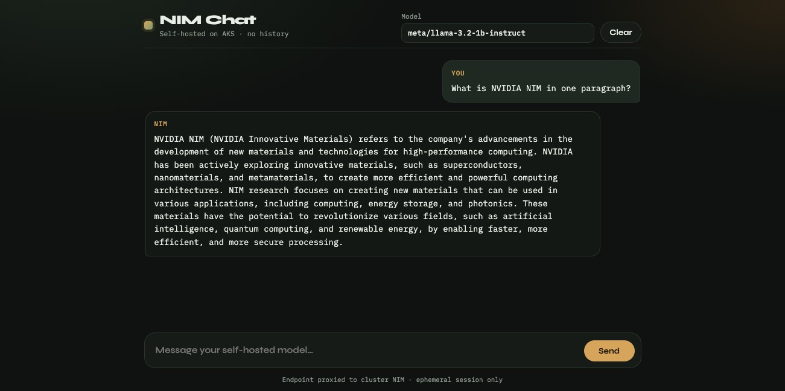

# Self-Host an LLM on AKS with NVIDIA GPU Operator and NIM

**Type:** Hands-on lab / architecture walkthrough  
**Audience:** Cloud / AI Platform Architects  
**Updated:** 2026-11-20

A complete path from an empty Azure subscription to an **OpenAI-compatible** self-hosted LLM on **AKS**, using the **NVIDIA GPU Operator** and **NVIDIA NIM**, plus an optional ChatGPT-style UI.

This post is based on a real lab run in **eastus** (November 2026) that was torn down afterward to stop billing. Automation lives in the public repo:

**Code:** [github.com/afsalashraf/aks-nim-llm-inference](https://github.com/afsalashraf/aks-nim-llm-inference)

---

## What you build

1. AKS cluster with a **CPU system pool**  
2. Dedicated **NVIDIA GPU node pool** (`--gpu-driver none`)  
3. **NVIDIA GPU Operator** (drivers, toolkit, device plugin)  
4. **NVIDIA NIM** serving an LLM over `/v1/chat/completions`  
5. Optional browser chat UI (nginx proxy → NIM)

```text
Client (curl / Chat UI)
        │
        ▼
┌──────────────────────────────────────────────┐
│  AKS                                         │
│  ┌─────────────┐    ┌─────────────────────┐  │
│  │ System pool │    │ GPU node pool       │  │
│  │ (CPU)       │    │ NVIDIA T4 / A100    │  │
│  └─────────────┘    │  • GPU Operator     │  │
│                     │  • NIM LLM pod      │  │
│                     │  • Model cache PVC  │  │
│                     │  • Chat UI (opt.)   │  │
│                     └─────────────────────┘  │
└──────────────────────────────────────────────┘
```

**Why NIM?** Packaged NVIDIA inference microservices with an OpenAI-style HTTP API — without assembling Triton / TensorRT-LLM yourself. For how NIM relates to vLLM and Triton, see the companion post: [NIM vs vLLM vs Triton vs TensorRT-LLM](/blog/nvidia-nim-vs-vllm-vs-triton-vs-tensorrt-llm).

---

## Lab outcomes (what actually worked)

| Layer | Choice in this lab |
| --- | --- |
| Region | `eastus` |
| Cluster | `aks-llm-nim` |
| System pool | `Standard_D2s_v4` × 1 |
| GPU pool | `Standard_NC4as_T4_v3` × 1 (`--gpu-driver none`) |
| GPU software | NVIDIA GPU Operator |
| Model | `meta/llama-3.2-1b-instruct:1.12.0` |
| API | OpenAI-compatible `/v1/chat/completions` |
| UI | Simple chat page (no history) |

Verified: CUDA **Test PASSED**, NIM health ready, chat completions + UI proxy working — then resource group deleted.


*Figure: Chat UI landing page in front of the in-cluster NIM service.*



*Figure: Browser chat proxied to `/api/v1/chat/completions` → NIM.*

---

## Architecture decisions

| Decision | Recommendation | Why |
| --- | --- | --- |
| GPU software | GPU Operator + `--gpu-driver none` | Matches NVIDIA’s recommended NIM/K8s path; you own the driver stack |
| System vs GPU pools | Split CPU system / GPU user pool | Keeps control-plane and system pods off expensive GPUs |
| Taint | `sku=gpu:NoSchedule` | Only workloads with matching tolerations land on GPU nodes |
| Starter model on T4 | Llama **3.2 1B** (+ `NIM_RELAX_MEM_CONSTRAINTS=1`) | T4 is 16 GB; 8B typically does not fit well |
| Prefer for 8B | A100-class SKU | Enough VRAM for `llama-3.1-8b-instruct`-class models |
| Cost control | Scale GPU pool to **0** or delete RG | GPU VMs dominate spend |

> **Cost warning:** Even a single GPU node can cost tens of dollars per day. Finish the lab, then scale to zero or tear down.

---

## Prerequisites

- Azure CLI **≥ 2.72.2** (required for `--gpu-driver`)
- `kubectl`, Helm 3  
- Azure subscription with **GPU quota** (Pay-As-You-Go — Free Trial usually cannot create GPU VMs)  
- NGC API key from [build.nvidia.com](https://build.nvidia.com) / NGC  

```bash
az version
kubectl version --client
helm version
az login
az account set --subscription "<YOUR_SUBSCRIPTION_ID>"
```

Clone the public automation:

```bash
git clone https://github.com/afsalashraf/aks-nim-llm-inference.git
cd aks-nim-llm-inference
chmod +x scripts/*.sh
source scripts/00-env.sh
export NGC_API_KEY="nvapi-..."
```

---

## Ordered runbook

| Step | Script | Purpose |
| --- | --- | --- |
| 1 | `01-create-aks.sh` | Resource group + AKS CPU system pool |
| 2 | `02-add-gpu-nodepool.sh` | GPU pool, label, taint, `--gpu-driver none` |
| 3 | `03-install-gpu-operator.sh` | Helm install Operator **with GPU taint tolerations** |
| 4 | `04-validate-gpu.sh` | CUDA `vectorAdd` job → **Test PASSED** |
| 5 | `05-deploy-nim.sh` | NGC secrets + NIM Helm + LoadBalancer `:8000` |
| 6 | `06-test-inference.sh` | Health, models, chat completion |
| 7 | `07-deploy-chat-ui.sh` | Optional ChatGPT-style UI |
| 99 | `99-teardown.sh` | Scale down / delete |

```bash
./scripts/01-create-aks.sh
./scripts/02-add-gpu-nodepool.sh
./scripts/03-install-gpu-operator.sh
./scripts/04-validate-gpu.sh
./scripts/05-deploy-nim.sh
./scripts/06-test-inference.sh
./scripts/07-deploy-chat-ui.sh   # optional

# when finished
./scripts/99-teardown.sh delete-all
```

Override defaults via env (`REGION`, `GPU_VM_SIZE`, `RG_NAME` / `RESOURCE_GROUP`, `CLUSTER_NAME` / `AKS_NAME`) — see `scripts/00-env.sh`.

---

## Critical details (do not skip)

### 1. `--gpu-driver none`

For the Operator path, skip AKS’s built-in NVIDIA driver install. The Operator owns drivers, toolkit, and device plugin.

### 2. Operator must tolerate your GPU taint

If Operator pods cannot schedule onto the GPU node, Kubernetes never advertises `nvidia.com/gpu`, and every GPU Job stays **Pending**.

### 3. Quota math for T4

One `Standard_NC4as_T4_v3` needs **4** vCPUs of `Standard NCASv3_T4` family quota — not “1 GPU” in the portal sense.

### 4. First NIM pull is slow

Expect **10–30+ minutes** on first image/model cache. `ContainerCreating` / `Pulling` for a long time is normal.

### 5. Model ↔ GPU fit

| GPU | Practical lab model |
| --- | --- |
| T4 16 GB | `meta/llama-3.2-1b-instruct` (+ relax mem constraints) |
| A100-class | `meta/llama-3.1-8b-instruct` (or larger per NVIDIA matrix) |

---

## NIM values sketch (T4 lab)

From `manifests/nim/values.yaml`:

```yaml
image:
  repository: nvcr.io/nim/meta/llama-3.2-1b-instruct
  tag: "1.12.0"

model:
  name: meta/llama-3.2-1b-instruct
  ngcAPISecret: ngc-api

env:
  - name: NIM_RELAX_MEM_CONSTRAINTS
    value: "1"

resources:
  limits:
    nvidia.com/gpu: 1
    memory: 20Gi

tolerations:
  - key: sku
    operator: Equal
    value: gpu
    effect: NoSchedule

nodeSelector:
  workload: gpu

service:
  type: LoadBalancer
```

Persist the model cache on a PVC (`managed-csi`) so restarts do not re-download everything.

---

## Test the API

Health and models:

```bash
curl -s "http://${NIM_EXTERNAL_IP}:8000/v1/health/ready"
curl -s "http://${NIM_EXTERNAL_IP}:8000/v1/models" | jq
```

Chat completion (OpenAI-compatible):

```bash
curl -s "http://${NIM_EXTERNAL_IP}:8000/v1/chat/completions" \
  -H "Content-Type: application/json" \
  -d '{
    "model": "meta/llama-3.2-1b-instruct",
    "messages": [
      {"role": "user", "content": "Explain Kubernetes GPU scheduling in 3 bullet points."}
    ],
    "max_tokens": 200,
    "temperature": 0.2
  }' | jq
```

Local alternative without a public IP:

```bash
kubectl -n nim port-forward svc/llm-nim-nim-llm 8000:8000
# then use http://127.0.0.1:8000
```

---

## Chat UI pattern

The UI (`web/`) is nginx + static HTML/JS. Browsers cannot safely call a different NIM origin (CORS), so nginx proxies `/api/...` to the in-cluster NIM Service. The browser talks to **one** origin — the Chat UI LoadBalancer.


*Figure: Multi-turn UI session against the self-hosted NIM endpoint.*

---

## Troubleshooting

| Symptom | Likely cause | Fix |
| --- | --- | --- |
| `unrecognized arguments: --gpu-driver` | Old Azure CLI | Upgrade ≥ 2.72.2 |
| `nvidia.com/gpu: 0` / missing | Operator not on GPU node | Check tolerations; wait for driver + device-plugin |
| NIM / CUDA Job Pending | No GPU / missing toleration | Taints, `nvidia.com/gpu` limits, node allocatable |
| ImagePullBackOff from `nvcr.io` | Bad NGC secret | Recreate with username `$oauthtoken` + API key |
| OOM / CrashLoop on T4 | Model too large | Use 1B profile or move to A100 |
| QuotaExceeded on node pool | No GPU family quota | Request quota or change region/SKU |
| PVC Pending | Wrong StorageClass | Set `persistence.storageClass` to a real class |

---

## Tear down / save money

Scale GPU pool to zero when idle:

```bash
az aks nodepool scale \
  --resource-group "$RESOURCE_GROUP" \
  --cluster-name "$AKS_NAME" \
  --name "$GPU_POOL_NAME" \
  --node-count 0
```

Or delete the lab entirely:

```bash
./scripts/99-teardown.sh delete-all
# or: az group delete --name "$RESOURCE_GROUP" --yes --no-wait
```

Rotate any NGC key that was pasted into logs or chat.

---

## Official references

- [Use NVIDIA GPU Operator on AKS](https://learn.microsoft.com/en-us/azure/aks/nvidia-gpu-operator)  
- [Use GPUs on AKS](https://learn.microsoft.com/en-us/azure/aks/use-nvidia-gpu)  
- [NVIDIA NIM on Azure](https://docs.nvidia.com/nim/large-language-models/latest/deployment/csp-deployment/azure.html)  
- [NIM Helm / Kubernetes](https://docs.nvidia.com/nim/large-language-models/latest/deployment/kubernetes-deployment/helm-k8s.html)  
- [NVIDIA GPU Operator](https://docs.nvidia.com/datacenter/cloud-native/gpu-operator/latest/index.html)  

---

## Takeaway

You can stand up a **private, OpenAI-compatible LLM** on AKS with a clear split of concerns:

> **AKS** orchestrates.  
> **GPU Operator** makes `nvidia.com/gpu` real.  
> **NIM** serves the model.  
> **Your app / UI** stays a thin client.

Start with the smallest GPU + model that proves the path, instrument health and latency, then move to larger SKUs or production networking (private endpoints, auth, Ingress + TLS) when the platform pattern is proven.

**Reproduce it:** [github.com/afsalashraf/aks-nim-llm-inference](https://github.com/afsalashraf/aks-nim-llm-inference)
