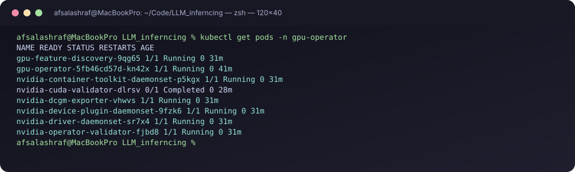
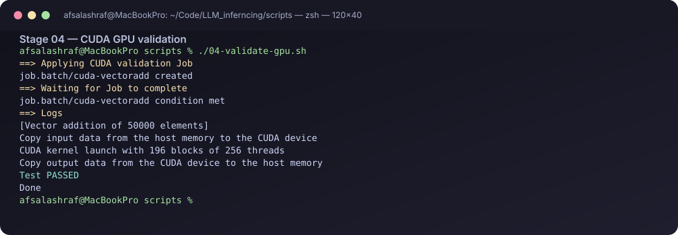
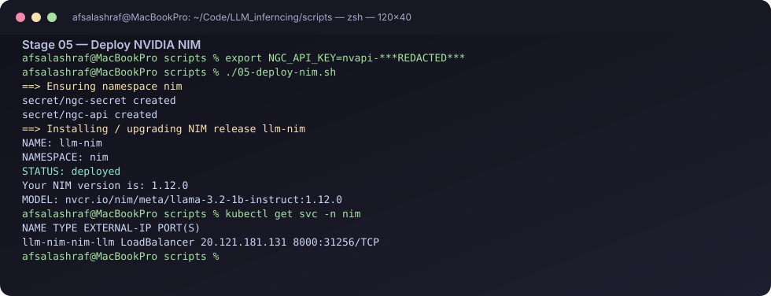
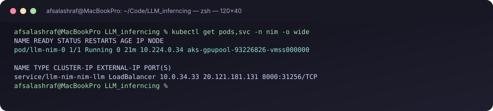
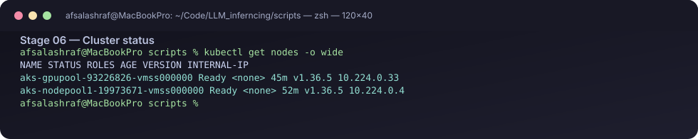
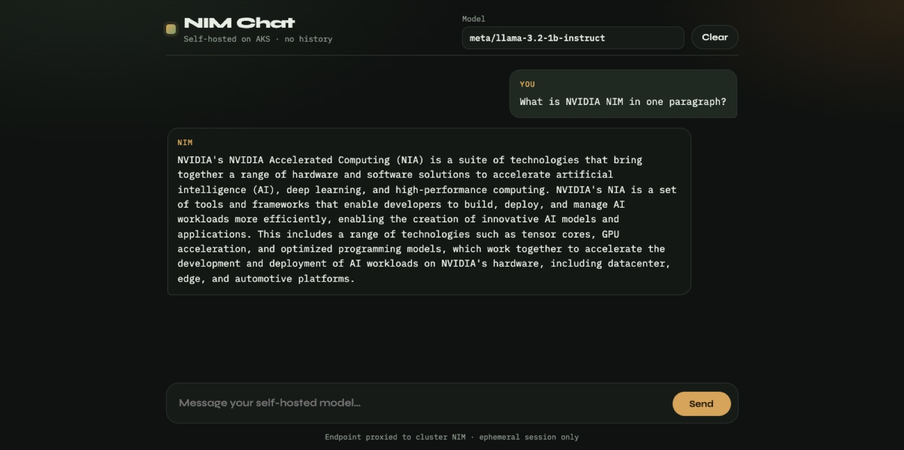
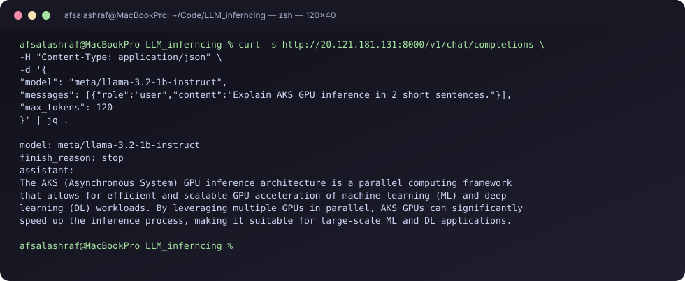

# Self-Host an LLM on Azure Kubernetes with NVIDIA GPUs — Complete Guide

**Type:** Hands-on lab / complete walkthrough  
**Audience:** Cloud engineers and architects — no prior GPU/K8s expertise required  
**Updated:** 2026-11-20

Understand **what** we built, **why** each technology is required, and **how** to reproduce every step — with screenshots from a real lab in **eastus** (November 2026), then torn down to stop billing.

**Reproduce with code:** [github.com/afsalashraf/aks-nim-llm-inference](https://github.com/afsalashraf/aks-nim-llm-inference)  
**Companion deep-dive:** [NIM vs vLLM vs Triton vs TensorRT-LLM](/blog/nvidia-nim-vs-vllm-vs-triton-vs-tensorrt-llm)

---

## Table of contents

1. [Plain-English story](#1-plain-english-story)
2. [Words you will see (glossary)](#2-words-you-will-see-glossary)
3. [What we built (big picture)](#3-what-we-built-big-picture)
4. [Why each major piece is needed](#4-why-each-major-piece-is-needed)
5. [Prerequisites (tools + accounts)](#5-prerequisites-tools--accounts)
6. [Money, Free Trial, and GPU quota (read carefully)](#6-money-free-trial-and-gpu-quota-read-carefully)
7. [Repo map — where everything lives](#7-repo-map--where-everything-lives)
8. [Step-by-step lab](#8-step-by-step-lab)
9. [ChatGPT-style web UI](#9-chatgpt-style-web-ui)
10. [How to talk to the model (curl)](#10-how-to-talk-to-the-model-curl)
11. [Problems we hit (and fixes)](#11-problems-we-hit-and-fixes)
12. [Tear down (stop paying)](#12-tear-down-stop-paying)
13. [Appendix — commands cheat sheet](#13-appendix--commands-cheat-sheet)

---

## 1. Plain-English story

Imagine you want a **private ChatGPT-like system** that runs on **your** cloud computers — not OpenAI’s.

To do that you need:

1. **Computers in the cloud** (Azure).
2. A **GPU** (special chip that runs AI models fast).
3. **Software that loads a model** and answers chat requests (NVIDIA NIM).
4. Optionally a **simple website** so humans can type questions.

This guide walks through creating all of that on **Azure Kubernetes Service (AKS)**.

We successfully:

- Created an AKS cluster  
- Added an NVIDIA **T4** GPU node  
- Installed the **NVIDIA GPU Operator**  
- Proved the GPU works with a CUDA test (**Test PASSED**)  
- Deployed **NVIDIA NIM** with model `meta/llama-3.2-1b-instruct`  
- Called `/v1/chat/completions` with `curl`  
- Deployed a **simple chat webpage** on a public IP  
- Captured screenshots/SVGs for documentation  
- Deleted the resource group to stop costs  

---

## 2. Words you will see (glossary)

| Term | Simple meaning |
|------|----------------|
| **Cloud** | Someone else’s data center you rent by the hour |
| **Azure** | Microsoft’s cloud |
| **VM / virtual machine** | A rented computer (CPU, RAM, maybe GPU) |
| **GPU** | Graphics chip used for AI math (here: NVIDIA T4) |
| **Kubernetes (K8s)** | Software that runs and restarts your apps in containers across machines |
| **AKS** | Azure’s managed Kubernetes — Azure runs the control plane for you |
| **Node** | One worker machine inside the Kubernetes cluster |
| **Node pool** | A group of nodes with the same VM size |
| **Pod** | Smallest deployable unit in Kubernetes (usually 1 container) |
| **Container** | Packaged app + libraries that runs the same everywhere |
| **Namespace** | A “folder” inside the cluster to group related apps |
| **Service / LoadBalancer** | Gives your app a stable network address; LoadBalancer can give a **public IP** |
| **Helm** | Package manager for Kubernetes (install complex apps with one chart) |
| **NVIDIA NIM** | NVIDIA’s ready-made LLM inference server (OpenAI-style HTTP API) |
| **NGC** | NVIDIA GPU Cloud — where you get NIM images (needs API key) |
| **Quota** | Azure limit on how many CPU/GPU cores you may create |
| **Taint / Toleration** | Rules that keep normal apps off GPU machines unless they “tolerate” the rule |
| **Device plugin** | Tiny Kubernetes component that advertises `nvidia.com/gpu` so pods can request a GPU |

You do **not** need to memorize these. Come back here when a word appears.

---

## 3. What we built (big picture)


*Figure: end-to-end flow from AKS create → GPU → Operator → CUDA → NIM → inference.*

### Mental model

```
You (browser or curl)
        │
        ▼
┌───────────────────┐     ┌─────────────────────────────────────┐
│ Chat UI (optional)│────▶│ AKS cluster                         │
│ public IP :80     │     │  • CPU system node (control apps)   │
└───────────────────┘     │  • GPU node (T4)                    │
                          │      - GPU Operator                 │
        curl ────────────▶│      - NIM pod (LLM)                │
                          │      - model cache disk (PVC)       │
                          └─────────────────────────────────────┘
```

### What ran in our lab

| Layer | Exact choice |
|-------|----------------|
| Resource group | `rg-llm-inference` |
| Cluster | `aks-llm-nim` (Kubernetes **1.36**) |
| System node | `Standard_D2s_v4` × 1 |
| GPU node | `Standard_NC4as_T4_v3` × 1 (1× NVIDIA T4, 16 GB GPU RAM) |
| Inference model | `meta/llama-3.2-1b-instruct` (1B parameters — fits T4) |
| Chat UI | nginx page + proxy in namespace `chat` |

---

## 4. Why each major piece is needed

### Why Azure / AKS?
You need always-on servers. AKS gives you Kubernetes without managing the control-plane VMs yourself.

### Why a separate GPU node pool?
GPUs are expensive. Keep cheap CPU nodes for system pods, and put GPUs only where AI runs.

### Why `--gpu-driver none`?
We want the **NVIDIA GPU Operator** to install drivers itself. If AKS also installs drivers, they can conflict.

### Why GPU Operator?
It installs/maintains:

- NVIDIA driver  
- container toolkit  
- device plugin (`nvidia.com/gpu`)  
- validators / metrics helpers  

Without it, Kubernetes cannot schedule “give me 1 GPU” pods correctly.

### Why NIM (not just “run Python”)?
NIM is NVIDIA’s packaged inference server. You get:

- Model download/cache  
- Optimized runtime  
- OpenAI-compatible HTTP API (`/v1/chat/completions`)  

### Why a Chat UI?
`curl` proves the API works. A webpage proves a human can use it like ChatGPT (no history needed for this lab).

### Why NGC / nvcr.io?
NIM containers and many model artifacts are distributed through NVIDIA’s registry. Your NGC API key authenticates image pulls and model downloads. Never commit the key.

### Why Helm?
GPU Operator and NIM ship as multi-resource packages (Deployments, DaemonSets, Services, RBAC). Helm installs and upgrades that bundle as one release.

### Why a PVC for the model cache?
The first NIM start downloads/builds a large cache. A PersistentVolumeClaim keeps that cache across pod restarts so you do not pay the download cost again.

### Why LoadBalancer Services in this lab?
Fastest way to reach NIM and the Chat UI from your laptop. For production, prefer private networking, Ingress + TLS, and an API gateway — not public GPU ports.

### Why split Chat UI into its own namespace?
Clear ownership: `nim` owns inference; `chat` owns the human front door. You can delete the UI without tearing down the model.

---

## 5. Prerequisites (tools + accounts)

### Accounts

1. **Azure subscription** (Pay-As-You-Go for GPU quota)  
2. **NVIDIA NGC account** + API key (for NIM images)  

### Software on your laptop

| Tool | Why |
|------|-----|
| Azure CLI (`az`) ≥ 2.72.2 | Create AKS / node pools (`--gpu-driver`) |
| `kubectl` | Talk to the Kubernetes cluster |
| Helm 3 | Install GPU Operator + NIM chart |
| `curl` / `jq` (optional) | Test APIs |

Check versions:

```bash
az version
kubectl version --client
helm version
```

Login:

```bash
az login
az account set --subscription "<YOUR_SUBSCRIPTION_ID>"
```

### Clone / open this repo

All scripts live under [`scripts/`](https://github.com/afsalashraf/aks-nim-llm-inference/tree/main/scripts). Defaults live in `scripts/00-env.sh`.

---

## 6. Money, Free Trial, and GPU quota (read carefully)

### Free Trial limitation
Azure Free Trial usually **cannot** create modern NVIDIA GPU VMs (T4/A100).  
GPU families often show **quota = 0**, and free accounts often **cannot raise quota**.

**What worked in this lab:** upgrade to **Pay-As-You-Go**, then request T4 quota.

### Quota is measured in vCPUs, not “1 GPU”
For one machine of size `Standard_NC4as_T4_v3` you need:

| Ask Azure for | Why |
|---------------|-----|
| **4 vCPUs** of `NCASv3_T4` family | That VM has **4 CPU cores + 1 T4 GPU** |

Asking for **1 vCPU** is wrong — Microsoft will reject it.

### Cost warning
A GPU node can cost many dollars per day.  
When practice is done:

```bash
./scripts/99-teardown.sh delete-all
```

---

## 7. Repo map — where everything lives

```text
aks-nim-llm-inference/          # public repo
├── README.md
├── scripts/                    # 01…07 + teardown
├── manifests/                  # CUDA job + NIM Helm values
└── web/                        # Chat UI (nginx + static files)
```

Clone:

```bash
git clone https://github.com/afsalashraf/aks-nim-llm-inference.git
cd aks-nim-llm-inference
```

---

## 8. Step-by-step lab

Run from:

```bash
cd aks-nim-llm-inference/scripts
chmod +x *.sh
```

### Shared settings (`00-env.sh`)

**Why:** one place for names/sizes so every script agrees.

Important defaults used in the successful run:

- Region: `eastus`  
- System VM: `Standard_D2s_v4` (2 vCPU) — DSv5 had 0 quota; `B2s` was blocked for AKS  
- GPU VM: `Standard_NC4as_T4_v3`  

```bash
source ./00-env.sh
```

---

### Step 1 — Create the AKS cluster (CPU system pool)

**Script:** `./01-create-aks.sh`  

**What it does:**

1. Creates resource group `rg-llm-inference`  
2. Creates AKS cluster `aks-llm-nim` with a **CPU** system node  
3. Downloads kubeconfig so `kubectl` works  

**Why system pool is CPU-only:**  
Kubernetes system pods should not sit on expensive GPUs.


*Figure: creating the resource group and AKS system pool.*

After this you can run:

```bash
kubectl get nodes
```

You should see one Ready node (system pool).

---

### Step 2 — Add the NVIDIA GPU node pool

**Script:** `./02-add-gpu-nodepool.sh`  

**What it does:** adds pool `gpupool` with:

- VM size `Standard_NC4as_T4_v3`  
- Label `workload=gpu`  
- Taint `sku=gpu:NoSchedule` (only special pods can land here)  
- `--gpu-driver none` (Operator will install drivers)  

**Why the taint?**  
Stops random workloads from consuming the GPU node.


*Figure: GPU pool created with driver install skipped.*

Verify nodes (live lab capture):


*Figure: system node + GPU node; GPU column shows `1` after Operator is healthy.*

---

### Step 3 — Install NVIDIA GPU Operator

**Script:** `./03-install-gpu-operator.sh`  

**What it does:** Helm-installs `nvidia/gpu-operator` into namespace `gpu-operator`, with **tolerations** for our custom `sku=gpu` taint.

**Why tolerations matter (we learned the hard way):**  
Without them, Operator pods stay on the CPU node, drivers never install on the GPU node, and Kubernetes reports **no GPU** (`nvidia.com/gpu` missing). CUDA jobs stay Pending forever.


*Figure: Operator deployed; GPU allocatable becomes 1.*

Operator pods look like this:



*Figure: driver, device-plugin, toolkit, validators running.*

---

### Step 4 — Validate the GPU with CUDA

**Script:** `./04-validate-gpu.sh`  
**Manifest:** `manifests/gpu-validation/cuda-vectoradd.yaml`  

**What it does:** runs NVIDIA’s sample `vectorAdd` job requesting `nvidia.com/gpu: 1`.

**Why:** before downloading a huge NIM image, prove the GPU path works.



*Figure: CUDA vector addition completed with **Test PASSED**.*

If this fails, do **not** deploy NIM yet — fix Operator/scheduling first.

---

### Step 5 — Deploy NVIDIA NIM (the LLM server)

**Script:** `./05-deploy-nim.sh`  
**Values:** `manifests/nim/values.yaml`  

**What it does:**

1. Creates namespace `nim`  
2. Creates Docker pull secret for `nvcr.io`  
3. Creates NGC API secret  
4. Installs NIM Helm chart  
5. Exposes a LoadBalancer on port **8000**  

**Why secrets?**  
NIM images and model artifacts are pulled from NVIDIA’s registry; the key authenticates you.

**Why 1B model on T4?**  
T4 has **16 GB** GPU memory. Llama-3.1-8B is typically too large. We used:

- image: `nvcr.io/nim/meta/llama-3.2-1b-instruct:1.12.0`  
- env: `NIM_RELAX_MEM_CONSTRAINTS=1`  



*Figure: Helm release deployed; service received a public IP.*

NIM pods/services:



*Figure: `llm-nim-0` Running and LoadBalancer EXTERNAL-IP assigned.*

**Patience note:** first image pull can take **10–30+ minutes**. Status may show `ContainerCreating` / `Pulling` for a long time. That is normal.

Cluster status snapshot:



---

### Step 6 — Test inference

**Script:** `./06-test-inference.sh`  

Calls:

1. `/v1/health/ready`  
2. `/v1/models`  
3. `/v1/chat/completions`  


*Figure: health OK + sample chat completion from the self-hosted model.*

More curl detail is in [section 10](#10-how-to-talk-to-the-model-curl).

---

## 9. ChatGPT-style web UI

**Script:** `./07-deploy-chat-ui.sh`  
**Code:** `web/static/` + `web/nginx.conf`  

### Why a proxy?
Browsers block cross-origin calls (CORS).  
The UI is served by nginx, and `/api/...` is **proxied inside the cluster** to NIM. The browser only talks to one origin (the Chat UI IP).

### What you get
- Simple chat page  
- **No history** (refresh clears messages)  
- Public LoadBalancer IP  

### Screenshots from the live website

#### Empty home screen


*Figure: NIM Chat landing page — model name, prompt chips, send box.*

#### Live conversation



*Figure: user question and model answer in the UI.*


*Figure: another live reply against the self-hosted NIM backend.*

#### Another reply capture (GPU scheduling prompt)


*Figure: interactive chat against the in-cluster NIM backend.*

### Redeploy after UI edits

```bash
./scripts/07-deploy-chat-ui.sh
```

---

## 10. How to talk to the model (curl)

While the cluster was live, NIM listened on a public IP (example from our run: `20.121.181.131:8000`).  
After teardown those IPs die — treat them as historical examples.

### Health check

**Why:** confirms the server finished loading the model.


### List models

**Why:** shows the exact model id string you must send in chat requests.


### Chat completion

**Why:** this is the same API shape many apps use for OpenAI.



### Chat UI proxy health

**Why:** proves the webpage’s `/api` path reaches NIM.


### Example request (copy/paste pattern)

```bash
export NIM_IP="<YOUR_LOADBALANCER_IP>"

curl -s "http://${NIM_IP}:8000/v1/chat/completions" \
  -H "Content-Type: application/json" \
  -d '{
    "model": "meta/llama-3.2-1b-instruct",
    "messages": [
      {"role": "user", "content": "Explain Kubernetes GPU scheduling in 3 short bullet points."}
    ],
    "max_tokens": 200,
    "temperature": 0.2
  }'
```

---

## 11. Problems we hit (and fixes)

These are real issues from this lab — expect them.

### 1) Insufficient vCPU for `DSv5`
**Symptom:** creating AKS with `Standard_D4s_v5` fails (quota remaining 0).  
**Fix:** use `Standard_D2s_v4` (or another family with quota).

### 2) `Standard_B2s` not allowed for AKS
**Symptom:** BadRequest listing allowed SKUs; `B2s` missing, `B2s_v2` / `D2s_v4` present.  
**Fix:** switch system pool to `Standard_D2s_v4`.

### 3) GPU quota request of 1 vCPU rejected
**Symptom:** Microsoft email saying vCore↔GPU conversion is wrong.  
**Fix:** request **4** vCPUs for one `NC4as_T4_v3`.

### 4) CUDA job timed out / Pending
**Symptom:** `Insufficient nvidia.com/gpu`.  
**Cause:** GPU Operator could not schedule onto tainted GPU node.  
**Fix:** Helm upgrade Operator with toleration for `sku=gpu:NoSchedule`.

### 5) NIM stays ContainerCreating for a long time
**Cause:** large image pull from `nvcr.io`.  
**Fix:** wait; watch events with `kubectl describe pod -n nim llm-nim-0`.

### 6) Wrong model size for T4
**Symptom:** OOM / crash on 8B models.  
**Fix:** use 1B instruct NIM + `NIM_RELAX_MEM_CONSTRAINTS=1`.

---

## 12. Tear down (stop paying)

**Why:** GPU + LoadBalancers continue billing while they exist.

```bash
cd aks-nim-llm-inference/scripts
./99-teardown.sh delete-all
```

This deletes resource group `rg-llm-inference` (cluster, disks, public IPs, everything in that RG).

Scale GPU to zero instead (keeps cluster, cheaper than full GPU):

```bash
./99-teardown.sh scale-zero
```

In our documentation pass, the RG was set to **Deleting**.

---

## 13. Appendix
---

## 13. Appendix — commands cheat sheet

```bash
# 0) env
source scripts/00-env.sh
export NGC_API_KEY="nvapi-..."   # for NIM only

# 1-7) lab
./scripts/01-create-aks.sh
./scripts/02-add-gpu-nodepool.sh
./scripts/03-install-gpu-operator.sh
./scripts/04-validate-gpu.sh
./scripts/05-deploy-nim.sh
./scripts/06-test-inference.sh
./scripts/07-deploy-chat-ui.sh

# inspect
kubectl get nodes -o wide
kubectl get pods -n gpu-operator
kubectl get pods,svc -n nim
kubectl get pods,svc -n chat
kubectl logs -n nim llm-nim-0 --tail=100

# cleanup
./scripts/99-teardown.sh scale-zero
./scripts/99-teardown.sh delete-all
```

### Official references

- [AKS + NVIDIA GPU Operator](https://learn.microsoft.com/en-us/azure/aks/nvidia-gpu-operator)  
- [Use GPUs on AKS](https://learn.microsoft.com/en-us/azure/aks/use-nvidia-gpu)  
- [NIM on Azure](https://docs.nvidia.com/nim/large-language-models/latest/deployment/csp-deployment/azure.html)  
- [NIM Helm / Kubernetes](https://docs.nvidia.com/nim/large-language-models/latest/deployment/kubernetes-deployment/helm-k8s.html)  

---

## Final takeaway

You now have a complete, beginner-readable path from **zero** to:

**AKS → NVIDIA GPU → GPU Operator → proven CUDA → NVIDIA NIM → curl API → Chat UI → teardown**

Every lab screenshot below sits next to the step it proves.  
If you can follow the “why” paragraphs, you can reproduce and operate this pattern with confidence.
