# Self-Host an LLM on Azure Kubernetes with NVIDIA GPUs — Complete Guide

**Type:** Hands-on lab / intermediate platform guide  
**Audience:** Cloud / AI platform engineers  
**Updated:** 2026-11-21

Build and operate a self-hosted, OpenAI-compatible LLM on **AKS** with the **NVIDIA GPU Operator** and **NVIDIA NIM** — including **why** each stack layer exists, how to **choose GPU + model**, and how **sampling / caching parameters** affect quality and cost. Screenshots are from a real **eastus** lab (November 2026), then torn down to stop billing.

**Reproduce with code:** [github.com/afsalashraf/aks-nim-llm-inference](https://github.com/afsalashraf/aks-nim-llm-inference)  
**Companion deep-dive:** [NIM vs vLLM vs Triton vs TensorRT-LLM](/blog/nvidia-nim-vs-vllm-vs-triton-vs-tensorrt-llm)

---

## Table of contents

1. [What this lab proves](#1-what-this-lab-proves)
2. [Glossary (platform + inference)](#2-glossary-platform--inference)
3. [What we built (big picture)](#3-what-we-built-big-picture)
4. [Why each major piece is needed](#4-why-each-major-piece-is-needed)
5. [NVIDIA stack on AKS — how the layers fit](#5-nvidia-stack-on-aks--how-the-layers-fit)
6. [Choosing GPU SKU and model](#6-choosing-gpu-sku-and-model)
7. [Inference parameters, KV cache, and model cache](#7-inference-parameters-kv-cache-and-model-cache)
8. [Prerequisites (tools + accounts)](#8-prerequisites-tools--accounts)
9. [Money, Free Trial, and GPU quota](#9-money-free-trial-and-gpu-quota)
10. [Repo map](#10-repo-map)
11. [Step-by-step lab](#11-step-by-step-lab)
12. [ChatGPT-style web UI](#12-chatgpt-style-web-ui)
13. [Calling the model (curl + API fields)](#13-calling-the-model-curl--api-fields)
14. [Tear down (stop paying)](#14-tear-down-stop-paying)
15. [Appendix — commands cheat sheet](#15-appendix--commands-cheat-sheet)

---

## 1. What this lab proves

Goal: a **private, OpenAI-compatible** chat/completions endpoint under **your** control plane — not a public SaaS model API.

Platform path:

1. **AKS** for orchestration  
2. **NVIDIA GPU** for inference compute  
3. **GPU Operator** so Kubernetes can schedule `nvidia.com/gpu`  
4. **NVIDIA NIM** as the inference microservice  
5. Optional **Chat UI** as a thin client  

What we completed in the lab:

- AKS + NVIDIA **T4** user pool (`--gpu-driver none`)  
- GPU Operator with custom taint tolerations  
- CUDA smoke test (**Test PASSED**)  
- NIM serving `meta/llama-3.2-1b-instruct`  
- `/v1/chat/completions` via `curl` + browser UI  
- Full teardown to stop spend  

---

## 2. Glossary (platform + inference)

| Term | Meaning in this lab |
|------|---------------------|
| **AKS** | Azure-managed Kubernetes control plane; you manage node pools and workloads |
| **Node pool** | Homogeneous VM group (CPU system pool vs GPU user pool) |
| **Taint / Toleration** | Keep non-GPU pods off GPU nodes unless they explicitly tolerate the taint |
| **Device plugin** | Advertises `nvidia.com/gpu` so pods can request GPUs as a resource |
| **NVIDIA NIM** | Packaged inference microservice with OpenAI-style HTTP APIs |
| **NGC / nvcr.io** | NVIDIA registry for NIM images and many model artifacts |
| **VRAM** | GPU memory — primary limit for model weights + KV cache |
| **KV cache** | Cached key/value attention state for generated tokens; grows with context length and concurrency |
| **TTFT** | Time to first token — interactive latency metric |
| **Tokens/sec** | Decode throughput after the first token |
| **Quantization** | Lower-precision weights (e.g. FP8/INT) to fit larger models in VRAM |
| **Temperature / top_p** | Sampling controls that change randomness vs focus of outputs |
| **Model cache (PVC)** | On-disk NIM download/build cache so restarts skip full re-pull |

---

## 3. What we built (big picture)

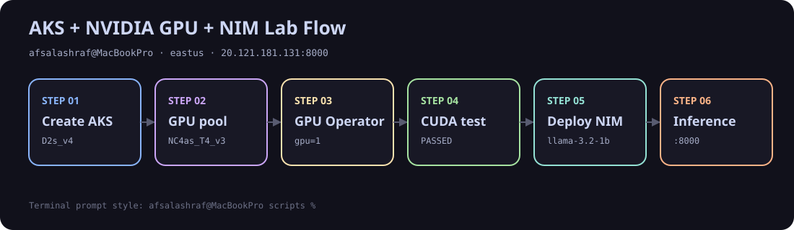

*Figure: end-to-end flow from AKS create → GPU → Operator → CUDA → NIM → inference.*

### Mental model

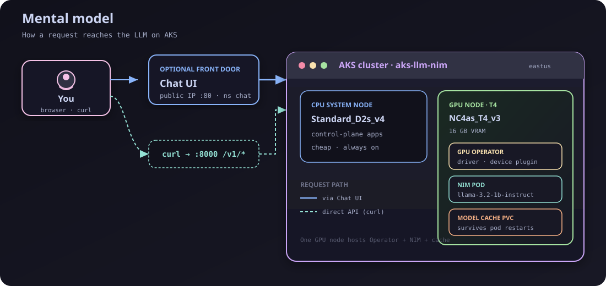

*Figure: two ways in (Chat UI or curl), one GPU node hosting Operator + NIM + model cache.*

### What ran in our lab

| Layer | Exact choice |
|-------|----------------|
| Resource group | `rg-llm-inference` |
| Cluster | `aks-llm-nim` (Kubernetes **1.36**) |
| System node | `Standard_D2s_v4` × 1 |
| GPU node | `Standard_NC4as_T4_v3` × 1 (1× NVIDIA T4, 16 GB GPU RAM) |
| Inference model | `meta/llama-3.2-1b-instruct` (1B parameters — fits T4) |
| Chat UI | nginx page + proxy in namespace `chat` |

---

## 4. Why each major piece is needed

### Why Azure / AKS?
You need always-on servers. AKS gives you Kubernetes without managing the control-plane VMs yourself.

### Why a separate GPU node pool?
GPUs are expensive. Keep cheap CPU nodes for system pods, and put GPUs only where AI runs.

### Why `--gpu-driver none`?
We want the **NVIDIA GPU Operator** to install drivers itself. If AKS also installs drivers, they can conflict.

### Why GPU Operator?
It installs/maintains:

- NVIDIA driver  
- container toolkit  
- device plugin (`nvidia.com/gpu`)  
- validators / metrics helpers  

Without it, Kubernetes cannot schedule “give me 1 GPU” pods correctly.

### Why NIM (not just “run Python”)?
NIM is NVIDIA’s packaged inference server. You get:

- Model download/cache  
- Optimized runtime  
- OpenAI-compatible HTTP API (`/v1/chat/completions`)  

### Why a Chat UI?
`curl` proves the API works. A webpage proves a human can use it like ChatGPT (no history needed for this lab).

### Why NGC / nvcr.io?
NIM containers and many model artifacts are distributed through NVIDIA’s registry. Your NGC API key authenticates image pulls and model downloads. Never commit the key.

### Why Helm?
GPU Operator and NIM ship as multi-resource packages (Deployments, DaemonSets, Services, RBAC). Helm installs and upgrades that bundle as one release.

### Why a PVC for the model cache?
The first NIM start downloads/builds a large cache. A PersistentVolumeClaim keeps that cache across pod restarts so you do not pay the download cost again.

### Why LoadBalancer Services in this lab?
Fastest way to reach NIM and the Chat UI from your laptop. For production, prefer private networking, Ingress + TLS, and an API gateway — not public GPU ports.

### Why split Chat UI into its own namespace?
Clear ownership: `nim` owns inference; `chat` owns the human front door. You can delete the UI without tearing down the model.

---

## 5. NVIDIA stack on AKS — how the layers fit

On this platform path, think in **layers**, not competing products:

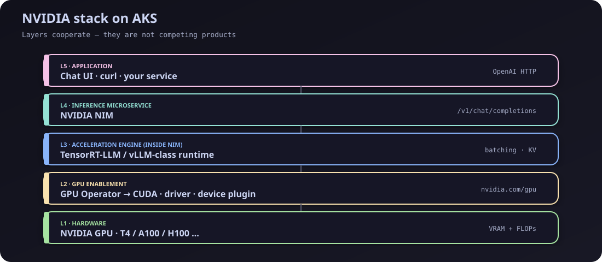

*Figure: each layer has one job; NIM packages the engine so you do not install Triton/TRT-LLM yourself for this lab.*

| Layer | Responsibility | In this lab |
| --- | --- | --- |
| **Orchestration** | Schedule pods, networking, restarts | AKS |
| **GPU enablement** | Driver, toolkit, `nvidia.com/gpu` | GPU Operator |
| **Inference service** | Load model, serve `/v1/*` | NIM |
| **Acceleration engine** | Kernels, batching, KV management | Inside NIM (e.g. TensorRT-LLM / vLLM-class stacks depending on NIM build) |
| **Hardware** | VRAM + FLOPs | Azure NVIDIA SKU |

**Practical implication:** you do **not** need to install Triton or TensorRT-LLM yourself for this lab. NIM packages a production inference path. You *do* need a correct GPU Operator + SKU/model fit, or the pod will never become Ready.

For when to compose NIM vs bare vLLM vs Triton + TensorRT-LLM, see the [companion comparison](/blog/nvidia-nim-vs-vllm-vs-triton-vs-tensorrt-llm).

### What “GPU ready” means in Kubernetes

Before NIM:

1. Node shows allocatable `nvidia.com/gpu: 1` (or more)  
2. CUDA validation Job can schedule and print **Test PASSED**  
3. Your NIM pod has `limits.nvidia.com/gpu` **and** matching **tolerations** / **nodeSelector**

If step 1 fails, step 3 is wasted time.

---

## 6. Choosing GPU SKU and model

Model choice is constrained first by **VRAM**, then by latency/quality targets.

### Rough sizing intuition

| GPU (examples) | VRAM | Practical starter models |
| --- | --- | --- |
| **T4** (`NC4as_T4_v3`) | 16 GB | Small instruct models (this lab: **Llama 3.2 1B**) |
| **A10 / L4 class** | ~24 GB | 7B–8B often feasible (profile-dependent) |
| **A100 40/80 GB** | 40/80 GB | 8B–70B with parallelism / quantization as required |
| **H100 / H200** | High | Larger models + higher concurrency |

Rules of thumb:

1. **Weights must fit** with headroom for **KV cache** and runtime.  
2. Longer contexts and more concurrent users raise KV-cache memory sharply.  
3. Official NIM support matrices matter — unofficial “it might fit” often OOMs.  
4. Prefer an **instruct / chat** NIM for conversational APIs; base models need different prompting.

### Lab choice explained

| Constraint | Decision |
| --- | --- |
| Available quota | 1× `Standard_NC4as_T4_v3` (4 vCPUs of T4 family) |
| VRAM | 16 GB |
| Model | `meta/llama-3.2-1b-instruct:1.12.0` |
| Escape hatch | `NIM_RELAX_MEM_CONSTRAINTS=1` for tight T4 profiles |

**Why not Llama 3.1 8B on this T4?**  
8B instruct NIMs typically need more VRAM than a comfortable T4 lab leaves after runtime + KV cache. Use A100-class (or a supported quantized/smaller profile) for 8B.

### Model attributes to check before you Helm-install

| Attribute | Why it matters |
| --- | --- |
| **Parameter count** | Dominant VRAM for weights |
| **Context length** | Caps prompt+output; larger max context ⇒ more KV memory at high concurrency |
| **Precision / quantization** | FP16 vs FP8/INT changes fit and speed |
| **TP / multi-GPU** | Big models may need tensor parallel across GPUs |
| **License / gating** | Some weights need Hugging Face tokens in addition to NGC |
| **NIM tag / chart version** | Pin image digests for reproducible labs |

---

## 7. Inference parameters, KV cache, and model cache

When you call `/v1/chat/completions`, you are not only “asking a question.” You are also telling the server **how creative to be**, **how long it may talk**, and **how much GPU work you allow**. Those knobs affect answer quality, latency, and cost.

### Two caches people mix up

| Cache | Where it lives | What it is for | Why you care |
| --- | --- | --- | --- |
| **Model cache (PVC)** | Disk on the node | Stores downloaded NIM / model files | First start is slow; later restarts skip a full re-download |
| **KV cache** | GPU memory while answering | Remembers attention state for tokens already seen | Makes generation fast; grows with longer chats and more users |

**Simple picture:** the PVC is like a **downloaded app install**. The KV cache is like **short-term working memory** while the model is talking. Wrong PVC → slow boots. Wrong KV sizing → OOM or fewer concurrent users.

### Temperature — “how random should the next word be?”

The model always has a ranked list of next-token candidates. **Temperature** stretches or squeezes that list:

| Setting | What happens in plain English | When you need it |
| --- | --- | --- |
| **`0` – `0.2`** | Picks safer, more repeatable answers | Docs demos, FAQ bots, ops runbooks, “explain this error” |
| **`0.3` – `0.5`** | Slight variety, still mostly on-topic | General chat assistants |
| **`0.7` – `0.9`** | More surprise and phrasing diversity | Brainstorming, creative copy |
| **Very high (`~1+`)** | Answers can wander or contradict | Rarely useful for platform tools |

**Why we need it:** without temperature control, every app gets the same “default personality.” Platform teams usually **force a low default** at the gateway so demos and internal tools stay consistent.

**Lab tip:** use **`0.1–0.3`** for screenshots and smoke tests so two runs look similar.

### `top_p` — “only consider the top slice of likely words”

`top_p` (nucleus sampling) keeps only the smallest set of tokens whose probabilities add up to `p` (for example `0.9`), then samples from that slice.

- **Low `top_p` (e.g. 0.5)** → narrower vocabulary → safer, sometimes duller  
- **High `top_p` (e.g. 0.95)** → more options → more variety  

**Why we need it:** another way to limit randomness. You usually **tune either temperature *or* top_p**, not both aggressively. For this lab, **`top_p: 0.9`** (or omit) with low temperature is enough.

### `max_tokens` — “hard stop on answer length”

This caps **how many tokens the model may generate** (not your prompt length).

| Why it matters | Reality |
| --- | --- |
| **Cost** | Every generated token burns GPU time |
| **Latency** | Longer answers take longer |
| **KV / VRAM** | Longer outputs keep more state in GPU memory |
| **UX** | Unbounded answers feel broken in APIs |

**Why we need it:** without a cap, a chatty reply can dominate a small T4. Start with **`128–256`** in labs; raise only when product needs longer answers.

### `stop` — “end the reply when you see this text”

Stop sequences tell the model to halt when it emits a marker (for example `\n\n` or `###`).

**Why we need it:** useful for structured outputs (JSON lines, bullet lists) so the model does not keep talking after the format is done.

### `stream` — “send words as they are ready”

- **`stream: false`** → wait for the full answer (easy for curl / scripts)  
- **`stream: true`** → tokens arrive continuously (feels faster in a chat UI)

**Why we need it:** streaming improves **perceived** speed (TTFT). Total GPU work is similar; you still need `max_tokens` and timeouts.

### `seed` (when the NIM build supports it)

Same prompt + same seed → more reproducible answers.

**Why we need it:** regression tests (“did our prompt change break the answer?”). Not every NIM image exposes seed the same way — check the model docs.

### Other request fields you will see

| Field | Simple meaning | Why platform teams set it |
| --- | --- | --- |
| **`model`** | Which served model name to hit | Routes traffic; must match what NIM registered |
| **`messages`** | Chat history (`system` / `user` / `assistant`) | `system` sets behavior; keep history short to save tokens + KV |
| **`top_k`** (if present) | Only look at the top *k* tokens | Another randomness limiter; often leave default |
| **`presence_penalty` / `frequency_penalty`** | Discourage repetition | Helpful for long chat; usually leave near `0` for Q&A |
| **`n`** | Ask for multiple completions | Multiplies cost — avoid in labs |

### Serving-side knobs (server, not the curl body)

These are set in Helm / env / gateway — they shape capacity for everyone:

| Knob | Plain English | Why you need it |
| --- | --- | --- |
| **Max concurrent requests / batch** | How many chats share the GPU at once | Higher throughput, worse per-user latency if overloaded |
| **Max context / input length** | Reject huge prompts early | Protects VRAM and stops accidental 50k-token dumps |
| **`NIM_RELAX_MEM_CONSTRAINTS`** | Allow tighter VRAM packing on small GPUs | Lab escape hatch on T4 — validate before production |
| **Replicas** | More NIM pods | Only helps if each replica has a GPU and the model fits |

### Quick “what should I set?” guide

| Your goal | Temperature | `max_tokens` | Stream |
| --- | --- | --- | --- |
| Platform demo / docs screenshot | `0.1–0.2` | `128–200` | off (curl) or on (UI) |
| Internal ops assistant | `0.2–0.4` | `256–512` | on in UI |
| Creative brainstorming | `0.7–0.9` | as needed | on |
| Extraction / classification | `0–0.2` | small | off |

### Recommended defaults for this lab

```json
{
  "model": "meta/llama-3.2-1b-instruct",
  "messages": [
    {"role": "system", "content": "You are a concise cloud platform assistant."},
    {"role": "user", "content": "Explain why a GPU node pool is separate from the system pool in 3 bullets."}
  ],
  "temperature": 0.2,
  "top_p": 0.9,
  "max_tokens": 200,
  "stream": false
}
```

**Bottom line for operators:** treat these fields as **product + capacity controls**, not optional cosmetics. Wrong temperature → flaky demos. Missing `max_tokens` → expensive, slow answers. Ignoring KV vs model cache → confusing OOMs vs slow cold starts.

---

## 8. Prerequisites (tools + accounts)

### Accounts

1. **Azure subscription** (Pay-As-You-Go for GPU quota)  
2. **NVIDIA NGC account** + API key (for NIM images)  

### Software on your laptop

| Tool | Why |
|------|-----|
| Azure CLI (`az`) ≥ 2.72.2 | Create AKS / node pools (`--gpu-driver`) |
| `kubectl` | Talk to the Kubernetes cluster |
| Helm 3 | Install GPU Operator + NIM chart |
| `curl` / `jq` (optional) | Test APIs |

Check versions:

```bash
az version
kubectl version --client
helm version
```

Login:

```bash
az login
az account set --subscription "<YOUR_SUBSCRIPTION_ID>"
```

### Clone / open this repo

All scripts live under [`scripts/`](https://github.com/afsalashraf/aks-nim-llm-inference/tree/main/scripts). Defaults live in `scripts/00-env.sh`.

---

## 9. Money, Free Trial, and GPU quota

### Free Trial limitation
Azure Free Trial usually **cannot** create modern NVIDIA GPU VMs (T4/A100).  
GPU families often show **quota = 0**, and free accounts often **cannot raise quota**.

**What worked in this lab:** upgrade to **Pay-As-You-Go**, then request T4 quota.

### Quota is measured in vCPUs, not “1 GPU”
For one machine of size `Standard_NC4as_T4_v3` you need:

| Ask Azure for | Why |
|---------------|-----|
| **4 vCPUs** of `NCASv3_T4` family | That VM has **4 CPU cores + 1 T4 GPU** |

Asking for **1 vCPU** is wrong — Microsoft will reject it.

### Cost warning
A GPU node can cost many dollars per day.  
When practice is done:

```bash
./scripts/99-teardown.sh delete-all
```

---

## 10. Repo map

```text
aks-nim-llm-inference/          # public repo
├── README.md
├── scripts/                    # 01…07 + teardown
├── manifests/                  # CUDA job + NIM Helm values
└── web/                        # Chat UI (nginx + static files)
```

Clone:

```bash
git clone https://github.com/afsalashraf/aks-nim-llm-inference.git
cd aks-nim-llm-inference
```

---

## 11. Step-by-step lab

Run from:

```bash
cd aks-nim-llm-inference/scripts
chmod +x *.sh
```

### Shared settings (`00-env.sh`)

**Why:** one place for names/sizes so every script agrees.

Important defaults used in the successful run:

- Region: `eastus`  
- System VM: `Standard_D2s_v4` (2 vCPU) — DSv5 had 0 quota; `B2s` was blocked for AKS  
- GPU VM: `Standard_NC4as_T4_v3`  

```bash
source ./00-env.sh
```

---

### Step 1 — Create the AKS cluster (CPU system pool)

**Script:** `./01-create-aks.sh`  

**What it does:**

1. Creates resource group `rg-llm-inference`  
2. Creates AKS cluster `aks-llm-nim` with a **CPU** system node  
3. Downloads kubeconfig so `kubectl` works  

**Why system pool is CPU-only:**  
Kubernetes system pods should not sit on expensive GPUs.

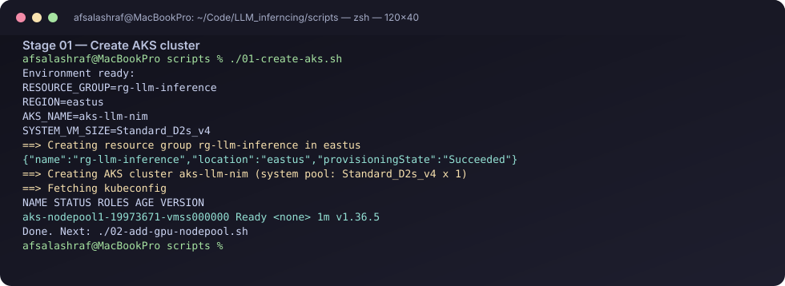

*Figure: creating the resource group and AKS system pool.*

After this you can run:

```bash
kubectl get nodes
```

You should see one Ready node (system pool).

---

### Step 2 — Add the NVIDIA GPU node pool

**Script:** `./02-add-gpu-nodepool.sh`  

**What it does:** adds pool `gpupool` with:

- VM size `Standard_NC4as_T4_v3`  
- Label `workload=gpu`  
- Taint `sku=gpu:NoSchedule` (only special pods can land here)  
- `--gpu-driver none` (Operator will install drivers)  

**Why the taint?**  
Stops random workloads from consuming the GPU node.

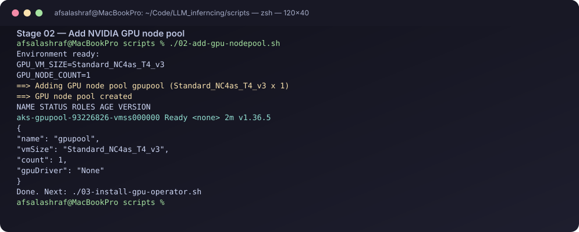

*Figure: GPU pool created with driver install skipped.*

Verify nodes (live lab capture):

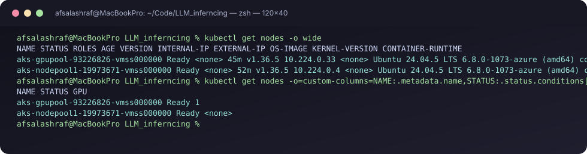

*Figure: system node + GPU node; GPU column shows `1` after Operator is healthy.*

---

### Step 3 — Install NVIDIA GPU Operator

**Script:** `./03-install-gpu-operator.sh`  

**What it does:** Helm-installs `nvidia/gpu-operator` into namespace `gpu-operator`, with **tolerations** for our custom `sku=gpu` taint.

**Why tolerations matter (we learned the hard way):**  
Without them, Operator pods stay on the CPU node, drivers never install on the GPU node, and Kubernetes reports **no GPU** (`nvidia.com/gpu` missing). CUDA jobs stay Pending forever.

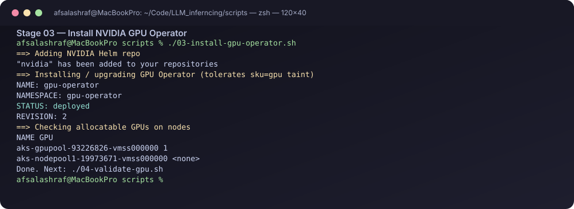

*Figure: Operator deployed; GPU allocatable becomes 1.*

Operator pods look like this:


*Figure: driver, device-plugin, toolkit, validators running.*

---

### Step 4 — Validate the GPU with CUDA

**Script:** `./04-validate-gpu.sh`  
**Manifest:** `manifests/gpu-validation/cuda-vectoradd.yaml`  

**What it does:** runs NVIDIA’s sample `vectorAdd` job requesting `nvidia.com/gpu: 1`.

**Why:** before downloading a huge NIM image, prove the GPU path works.


*Figure: CUDA vector addition completed with **Test PASSED**.*

If this fails, do **not** deploy NIM yet — fix Operator/scheduling first.

---

### Step 5 — Deploy NVIDIA NIM (the LLM server)

**Script:** `./05-deploy-nim.sh`  
**Values:** `manifests/nim/values.yaml`  

**What it does:**

1. Creates namespace `nim`  
2. Creates Docker pull secret for `nvcr.io`  
3. Creates NGC API secret  
4. Installs NIM Helm chart  
5. Exposes a LoadBalancer on port **8000**  

**Why secrets?**  
NIM images and model artifacts are pulled from NVIDIA’s registry; the key authenticates you.

**Why 1B model on T4?**  
T4 has **16 GB** GPU memory. After runtime overhead, an 8B instruct NIM is usually too tight. We used:

- image: `nvcr.io/nim/meta/llama-3.2-1b-instruct:1.12.0`  
- env: `NIM_RELAX_MEM_CONSTRAINTS=1` (lab escape hatch on constrained VRAM — validate quality/stability before calling it “production ready”)

**What to change for a larger model later**

1. Pick a GPU SKU with enough VRAM (often A100-class for 8B)  
2. Update `image.repository` / `tag` and `model.name` in `manifests/nim/values.yaml`  
3. Revisit CPU/memory requests so the node is not starved by GPU Operator sidecars  
4. Re-test with your real `temperature` / `max_tokens` profile — not only “hello world”  


*Figure: Helm release deployed; service received a public IP.*

NIM pods/services:


*Figure: `llm-nim-0` Running and LoadBalancer EXTERNAL-IP assigned.*

**Patience note:** first image pull can take **10–30+ minutes**. Status may show `ContainerCreating` / `Pulling` for a long time. That is normal.

Cluster status snapshot:


---

### Step 6 — Test inference

**Script:** `./06-test-inference.sh`  

Calls:

1. `/v1/health/ready`  
2. `/v1/models`  
3. `/v1/chat/completions`  

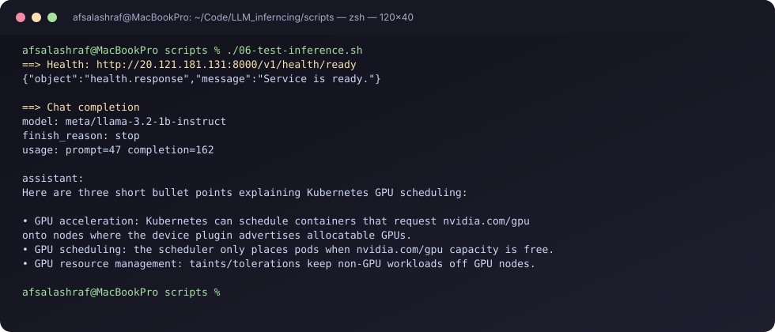

*Figure: health OK + sample chat completion from the self-hosted model.*

More curl detail is in [section 13](#13-calling-the-model-curl--api-fields).

---

## 12. ChatGPT-style web UI

**Script:** `./07-deploy-chat-ui.sh`  
**Code:** `web/static/` + `web/nginx.conf`  

### Why a proxy?
Browsers block cross-origin calls (CORS).  
The UI is served by nginx, and `/api/...` is **proxied inside the cluster** to NIM. The browser only talks to one origin (the Chat UI IP).

### What you get
- Simple chat page  
- **No history** (refresh clears messages)  
- Public LoadBalancer IP  

### Screenshots from the live website

#### Empty home screen

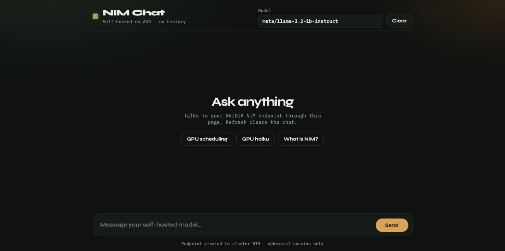

*Figure: NIM Chat landing page — model name, prompt chips, send box.*

#### Live conversation


*Figure: user question and model answer in the UI.*


*Figure: another live reply against the self-hosted NIM backend.*

#### Another reply capture (GPU scheduling prompt)

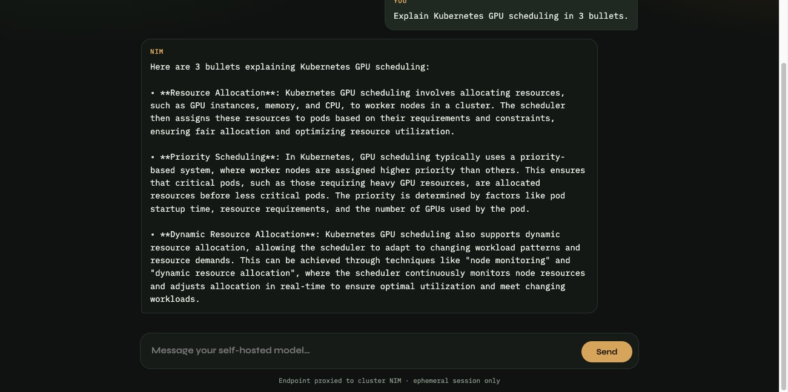

*Figure: interactive chat against the in-cluster NIM backend.*

### Redeploy after UI edits

```bash
./scripts/07-deploy-chat-ui.sh
```

---

## 13. Calling the model (curl + API fields)

While the cluster was live, NIM listened on a public IP (example from our run: `20.121.181.131:8000`).  
After teardown those IPs die — treat them as historical examples.

### Health check

**Why:** confirms the server finished loading the model.

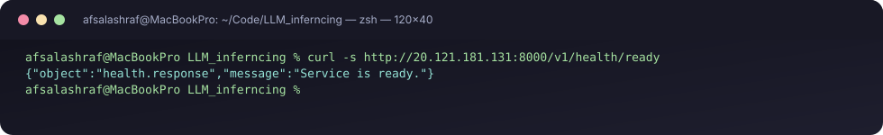

### List models

**Why:** shows the exact model id string you must send in chat requests.

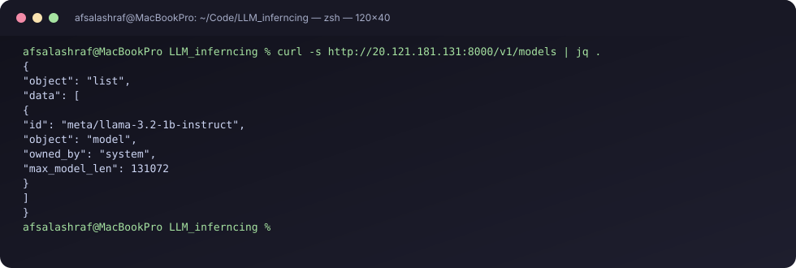

### Chat completion

**Why:** this is the same API shape many apps use for OpenAI.


### Chat UI proxy health

**Why:** proves the webpage’s `/api` path reaches NIM.

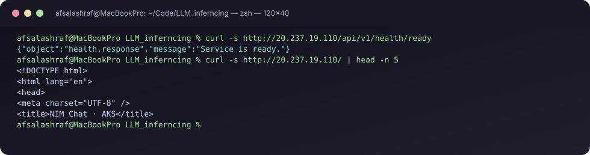

### Example request (copy/paste pattern)

```bash
export NIM_IP="<YOUR_LOADBALANCER_IP>"

curl -s "http://${NIM_IP}:8000/v1/chat/completions" \
  -H "Content-Type: application/json" \
  -d '{
    "model": "meta/llama-3.2-1b-instruct",
    "messages": [
      {"role": "system", "content": "You are a concise cloud platform assistant."},
      {"role": "user", "content": "Explain Kubernetes GPU scheduling in 3 short bullet points."}
    ],
    "temperature": 0.2,
    "top_p": 0.9,
    "max_tokens": 200,
    "stream": false
  }' | jq
```

### Reading the response like a platform engineer

Typical JSON includes:

- `choices[].message.content` — model text  
- `usage.prompt_tokens` / `completion_tokens` — billable/capacity signals even on self-hosted GPUs (they map to time and KV pressure)  
- `model` — confirm the served id matches what you requested  

If latency spikes with long chats, suspect **context growth** (more prompt tokens ⇒ more prefill work and KV memory), not only “the GPU is slow.”

### Streaming (optional)

```bash
curl -N "http://${NIM_IP}:8000/v1/chat/completions" \
  -H "Content-Type: application/json" \
  -d '{
    "model": "meta/llama-3.2-1b-instruct",
    "messages": [{"role": "user", "content": "List 5 AKS GPU best practices."}],
    "temperature": 0.3,
    "max_tokens": 256,
    "stream": true
  }'
```

Streaming improves perceived TTFT in UIs; still enforce `max_tokens` and gateway timeouts.

---

## 14. Tear down (stop paying)

**Why:** GPU + LoadBalancers continue billing while they exist.

```bash
cd aks-nim-llm-inference/scripts
./99-teardown.sh delete-all
```

This deletes resource group `rg-llm-inference` (cluster, disks, public IPs, everything in that RG).

Scale GPU to zero instead (keeps cluster, cheaper than full GPU):

```bash
./99-teardown.sh scale-zero
```

In our documentation pass, the RG was set to **Deleting**.

---

## 15. Appendix — commands cheat sheet

```bash
# 0) env
source scripts/00-env.sh
export NGC_API_KEY="nvapi-..."   # for NIM only

# 1-7) lab
./scripts/01-create-aks.sh
./scripts/02-add-gpu-nodepool.sh
./scripts/03-install-gpu-operator.sh
./scripts/04-validate-gpu.sh
./scripts/05-deploy-nim.sh
./scripts/06-test-inference.sh
./scripts/07-deploy-chat-ui.sh

# inspect
kubectl get nodes -o wide
kubectl get pods -n gpu-operator
kubectl get pods,svc -n nim
kubectl get pods,svc -n chat
kubectl logs -n nim llm-nim-0 --tail=100

# cleanup
./scripts/99-teardown.sh scale-zero
./scripts/99-teardown.sh delete-all
```

### Official references

- [AKS + NVIDIA GPU Operator](https://learn.microsoft.com/en-us/azure/aks/nvidia-gpu-operator)  
- [Use GPUs on AKS](https://learn.microsoft.com/en-us/azure/aks/use-nvidia-gpu)  
- [NIM on Azure](https://docs.nvidia.com/nim/large-language-models/latest/deployment/csp-deployment/azure.html)  
- [NIM Helm / Kubernetes](https://docs.nvidia.com/nim/large-language-models/latest/deployment/kubernetes-deployment/helm-k8s.html)  

---

## Final takeaway

You now have an intermediate, reproducible path:

**AKS → NVIDIA GPU → GPU Operator → CUDA proof → NIM → tuned `/v1/chat/completions` → Chat UI → teardown**

Remember the platform lessons:

1. **Stack layers are complementary** — Operator makes GPUs schedulable; NIM serves the model.  
2. **SKU + model + context must fit VRAM** including KV cache, not just weights.  
3. **API parameters are capacity controls** — `temperature`, `top_p`, and especially `max_tokens` change cost and latency.  
4. **Disk model cache ≠ KV cache** — PVC saves pull time; KV lives in GPU memory at runtime.  

Every lab screenshot sits next to the step it proves. Use the public repo scripts to reproduce, then harden networking/auth before production.
