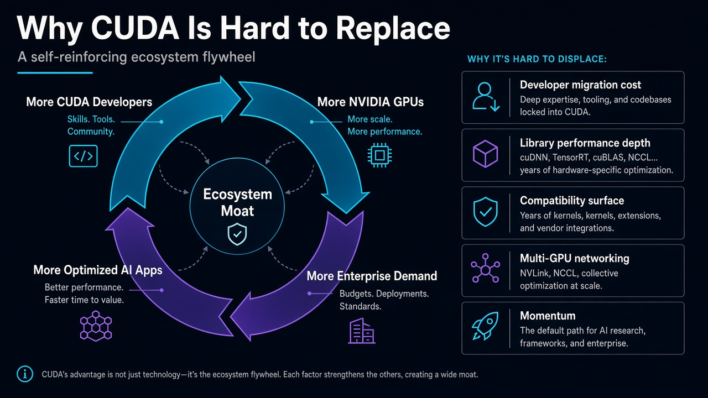
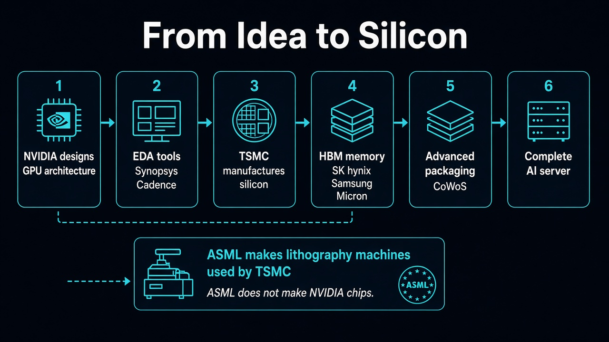

# CUDA Explained Simply: Why NVIDIA Still Leads AI Computing

**Type:** Architecture deep-dive  
**Audience:** Cloud / AI Platform Architects  
**Updated:** 2026-11-23

People often say: “NVIDIA leads because of CUDA.”

That is partly true. But it is incomplete.

NVIDIA’s real advantage is a **full working system**:
chips + software + networking + developer habits + partners who manufacture the silicon.

This article explains that story in plain language:

1. What CUDA is (in simple words)  
2. Why other companies cannot easily replace it  
3. Why China still struggles to clone the same stack  
4. What TSMC and ASML actually do (and do not do)  
5. Why NVIDIA still wins even when rivals use the same factories  

---

## 1. The big picture in one minute

Think of AI computing like a city:

| City piece | AI equivalent | Simple meaning |
| --- | --- | --- |
| Roads and traffic rules | CUDA + libraries | How software talks to GPUs |
| Cars and engines | NVIDIA GPUs | The machines that do the work |
| Highways between cities | NVLink / InfiniBand | How many GPUs talk to each other |
| Car factory | TSMC | Who builds the chips |
| Factory machine maker | ASML | Who builds the machines that print chips |

NVIDIA is strongest at the **roads + cars + highways** part.  
TSMC and ASML make advanced factories possible for many companies, not only NVIDIA.

---

## 2. What is CUDA, in simple words?

**CUDA** means **Compute Unified Device Architecture**.

NVIDIA launched it in **2006**.

### Before CUDA

GPUs were mostly for graphics: games, video, 3D.

### After CUDA

Developers could use the same GPU power for general computing, especially AI math.

### Easy example

Training an AI model needs huge matrix math.

- A **CPU** has fewer strong cores. It does work one chunk at a time (comparatively).  
- A **GPU** has thousands of smaller workers. It can do many tiny calculations together.

CUDA is the toolkit that lets your AI software send that work to the GPU and manage it.

**One sentence:**  
CUDA is the **translator and toolkit** between AI software and NVIDIA GPUs.

---

## 3. CUDA is not just one language

Many people think CUDA is only a programming language. It is a whole toolbox.

| Layer | What sits here | What it means in plain English |
| --- | --- | --- |
| Application | PyTorch, TensorFlow, LLMs | What the user/business wants to run |
| CUDA toolkit | Runtime, compiler, APIs | How code is prepared and run on GPU |
| Libraries | cuDNN, cuBLAS, NCCL, TensorRT | Ready-made fast building blocks |
| GPU hardware | CUDA cores, Tensor Cores, memory | Physical compute engine |
| Physical product | H100, H200, Blackwell | The actual card / accelerator |

### Important libraries (plain English)

| Tool | Simple job |
| --- | --- |
| **CUDA Runtime** | Starts and manages GPU work |
| **CUDA Compiler** | Turns GPU code into something the GPU can run |
| **cuDNN** | Speeds up deep learning operations |
| **cuBLAS** | Speeds up matrix math |
| **NCCL** | Helps many GPUs share training work |
| **TensorRT** | Makes inference (serving models) faster |
| **Nsight** | Helps find performance problems |

NVIDIA has spent nearly **20 years** improving these pieces.  
That long investment is a big reason CUDA feels “special.”

---

## 4. Why can’t AMD, Intel, or Qualcomm just copy CUDA?

They **can** build alternatives. They already have.

| Company | Their software path |
| --- | --- |
| NVIDIA | CUDA |
| AMD | ROCm / HIP |
| Intel | oneAPI / SYCL |
| Huawei | CANN |

So the real question is not:

> “Can someone invent another CUDA?”

The real question is:

> “Can someone match CUDA’s speed, maturity, and developer adoption at the same time?”

That is much harder.

### Reason 1: Millions of apps already speak CUDA

If a company moves away from CUDA, teams may need to:

- rewrite GPU code  
- replace libraries  
- rebuild kernels  
- re-check accuracy  
- re-tune multi-GPU training  

This is a large migration project, not a small switch.

### Reason 2: Optimized libraries are the secret sauce

Having a GPU and an API is not enough.  
You also need highly tuned libraries for many model types and sizes. NVIDIA has done this for years.

### Reason 3: Compatibility never stands still

AI models and frameworks keep changing.  
A competitor must catch up **and** keep up.

### Reason 4: Big AI jobs need many GPUs talking well

Large model training is not one GPU. It can be hundreds or thousands.

NVIDIA also built:

- **NVLink / NVSwitch** for fast GPU-to-GPU links  
- **NCCL** for collective communication  
- Strong networking options for multi-server clusters  

Software + chip + network are designed together.

### Reason 5: The flywheel effect

More NVIDIA GPUs  
→ more developers learn CUDA  
→ more apps are optimized for NVIDIA  
→ more companies buy NVIDIA  
→ even more developers join  

This cycle reinforces itself. That is the ecosystem moat.

---

## 5. What about China? Why is cloning so hard?

China has strong engineers and growing AI chip efforts.  
Huawei is a clear example of trying to build a full stack:

| NVIDIA-style piece | Huawei-style piece |
| --- | --- |
| AI chip | Ascend |
| Programming stack | CANN |
| AI framework | MindSpore |
| Systems / appliances | Atlas |

### So why is it still hard?

Because success needs **all of these together**:

1. Competitive chip performance  
2. Mature software tools  
3. Compatibility with existing AI apps  
4. Reliable multi-chip scaling  
5. Large production capacity  
6. Developers willing to switch  

China can design chips.  
Matching NVIDIA’s full ecosystem quality at global scale is the harder part.

There is also a manufacturing challenge (advanced machines and process technology), covered next.

---

## 6. Who builds NVIDIA chips? Meet TSMC

NVIDIA mostly designs chips.  
It usually does **not** run the leading-edge factories itself. This model is called **fabless**.

| Who | What they do |
| --- | --- |
| **NVIDIA** | Designs the GPU and AI platform |
| **TSMC** | Manufactures the silicon (and advanced packaging such as CoWoS) |
| **SK hynix / Samsung / Micron** | Provide high-bandwidth memory (HBM) |
| **Synopsys / Cadence** | Provide chip design software (EDA) |
| **Server vendors** | Build complete systems (GPU + CPU + cooling + network) |

### Key fact many people miss

TSMC also builds chips for **AMD, Apple, Qualcomm**, and others.

So NVIDIA’s lead is **not** “only NVIDIA can use TSMC.”  
Rivals can use advanced manufacturing too.

---

## 7. Who builds the machines that build chips? Meet ASML

To print tiny circuits on silicon, factories need special machines.  
The leader for the most advanced machines is **ASML** (Netherlands).

### What is lithography?

Imagine drawing extremely tiny patterns on a wafer using light.  
That process is lithography.

**EUV** (Extreme Ultraviolet) uses very short-wavelength light to print finer patterns needed for advanced chips.

### Simple manufacturing steps

1. Prepare silicon wafer  
2. Add light-sensitive coating  
3. Expose pattern with lithography machine  
4. Develop the pattern  
5. Etch / add materials  
6. Repeat for many layers  
7. Test and package the chip  

### Critical clarification

- **ASML** makes lithography machines  
- **TSMC** uses those machines to manufacture chips  
- **NVIDIA** designs the chips TSMC manufactures  

ASML does **not** manufacture NVIDIA GPUs.

### Why China cannot simply buy every ASML machine

Export controls limit China’s access to ASML’s most advanced **EUV** systems.  
China can still make advanced chips with other methods, but the leading-edge path becomes harder and more expensive.

---

## 8. If rivals also use TSMC, why is NVIDIA still ahead?

Because a factory is only one part of the product.

Winning AI platforms needs:

- better GPU architecture  
- better memory behavior (especially HBM bandwidth)  
- better multi-GPU communication  
- better software libraries  
- better full-system design  

| Company | Main focus | Strength in plain English |
| --- | --- | --- |
| **NVIDIA** | GPUs + AI platforms | Strongest full stack for large AI today |
| **AMD** | CPUs + Instinct GPUs | Serious competitor; ROCm is improving |
| **Intel** | CPUs + accelerators | Strong CPU base; AI stack still catching up |
| **Qualcomm** | Mobile / edge / AI PCs | Excellent power efficiency; not mainly giant training clusters |

AMD and Intel are capable competitors.  
NVIDIA’s edge is years of **end-to-end** optimization, not a secret exclusive factory.

---

## 9. The full semiconductor map (who depends on whom)

| Layer | Examples | Responsibility |
| --- | --- | --- |
| AI chip design | NVIDIA, AMD, Huawei | Invent the architecture |
| Chip manufacturing | TSMC, Samsung, Intel | Build the silicon |
| Lithography tools | ASML | Print ultra-fine circuits |
| Design tools | Synopsys, Cadence | Help design complex chips |
| HBM memory | SK hynix, Samsung, Micron | Feed GPUs with fast memory |
| Packaging | TSMC, ASE, Amkor | Assemble advanced chip packages |
| AI software | NVIDIA, AMD, Intel, Huawei | Make chips usable for developers |
| AI systems | NVIDIA, Dell, HPE, Supermicro | Deliver complete machines |

**No single company owns everything.**

That is why “clone NVIDIA” really means “rebuild a whole industrial ecosystem.”

---

## 10. NVIDIA’s real advantages, ranked simply

| Rank | Advantage | Why it matters |
| --- | --- | --- |
| 1 | CUDA ecosystem | Developers already know it and trust it |
| 2 | GPU architecture | Excellent parallel AI compute |
| 3 | Networking / scale-out | Many GPUs can work as one system |
| 4 | Full-stack integration | Hardware and software fit together |
| 5 | Developer momentum | Huge library of optimized apps and models |
| 6 | Supply partnerships | Access to advanced manufacturing and packaging |

CUDA is the most famous piece.  
The durable moat is **CUDA + chips + networking + ecosystem + systems**.

---

## 11. What you should learn next (platform architect path)

If you design AI platforms, learn these seven pieces in order:

1. **CUDA** — how software talks to the GPU  
2. **Tensor Cores** — special AI math engines  
3. **HBM** — why memory bandwidth matters so much  
4. **NVLink / NVSwitch** — GPU-to-GPU links  
5. **InfiniBand / RoCE** — server-to-server links  
6. **NCCL** — communication for distributed training  
7. **NIM / vLLM / Triton / TensorRT-LLM** — how inference is deployed  

Related posts on this site:

- [NVIDIA NIM vs vLLM vs Triton vs TensorRT-LLM](/blog/nvidia-nim-vs-vllm-vs-triton-vs-tensorrt-llm)  
- [Self-Host an LLM on AKS with NVIDIA GPUs](/blog/aks-nim-llm-inference-on-azure)  

---

## Final takeaway

> CUDA is the software bridge.  
> The GPU is the engine.  
> HBM is the fuel pipe.  
> NVLink and InfiniBand are the highways.  
> TSMC builds the silicon.  
> ASML builds critical factory machines.

NVIDIA does not win only because of one secret chip.  
NVIDIA wins because the **whole stack works together**, and millions of developers already build on it.
