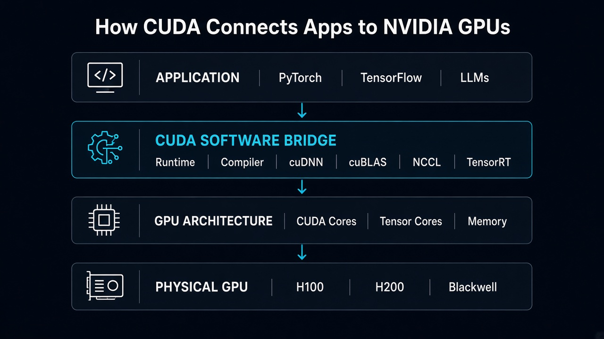
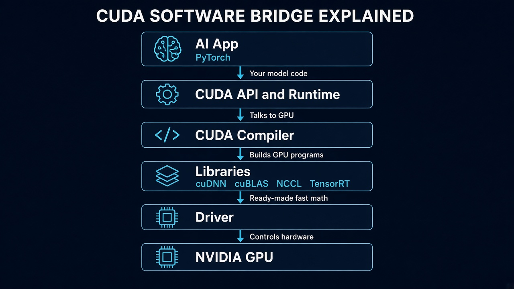
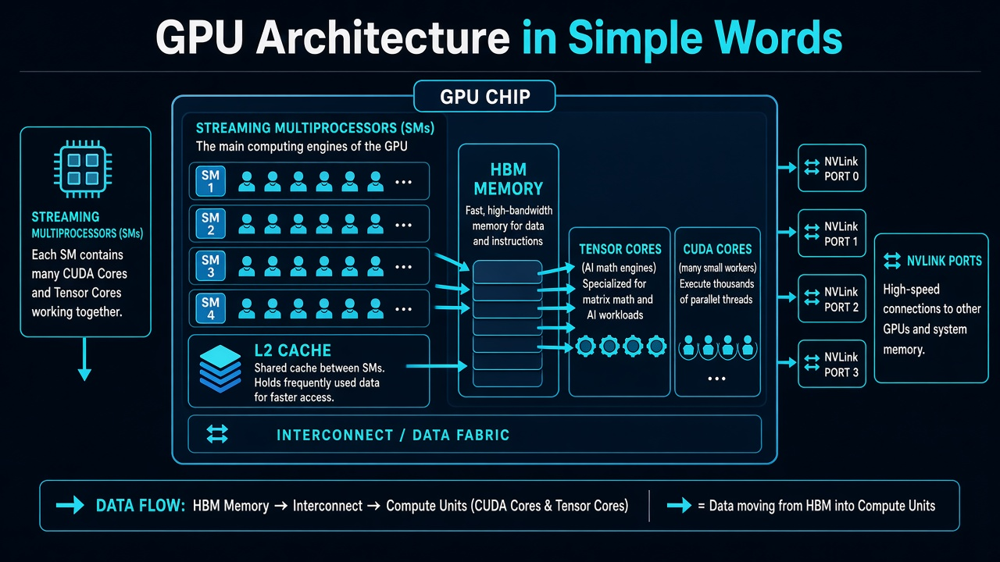
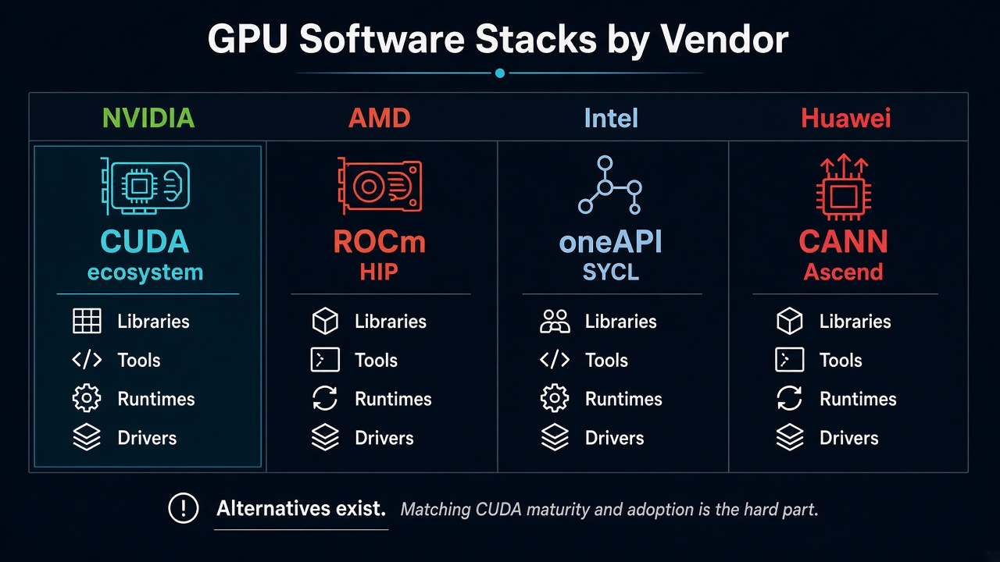
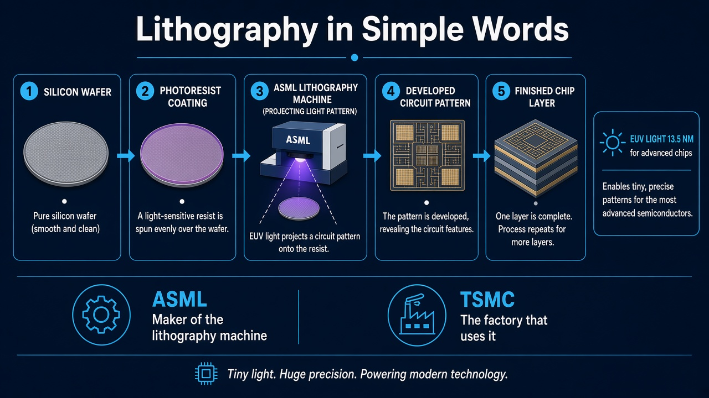

# CUDA Explained Simply: Why NVIDIA Still Leads AI Computing

**Type:** Architecture deep-dive  
**Audience:** Cloud / AI Platform Architects  
**Updated:** 2026-11-23

People often say: “NVIDIA leads because of CUDA.”

That is partly true. But it is incomplete.

NVIDIA’s real advantage is a **full working system**:
chips + software + networking + developer habits + partners who manufacture the silicon.

This article explains that story in plain language:

1. What CUDA is  
2. How the CUDA software bridge works  
3. How GPU architecture works  
4. Why CUDA is hard to replace  
5. Where TSMC fits  
6. ASML and lithography in brief  
7. Why advanced GPUs face export / shipping limits  

---

## 1. The big picture in one minute

Think of AI computing like a city:

| City piece | AI equivalent | Simple meaning |
| --- | --- | --- |
| Roads and traffic rules | CUDA + libraries | How software talks to GPUs |
| Cars and engines | NVIDIA GPUs | The machines that do the work |
| Highways between cities | NVLink / InfiniBand | How many GPUs talk to each other |
| Car factory | TSMC | Who builds the chips |
| Factory machine maker | ASML | Who builds the machines that print chips |

NVIDIA is strongest at the **roads + cars + highways** part.  
TSMC and ASML make advanced factories possible for many companies, not only NVIDIA.

---

## 2. What is CUDA, in simple words?

**CUDA** means **Compute Unified Device Architecture**.

NVIDIA launched it in **2006**.

### Before CUDA

GPUs were mostly for graphics: games, video, 3D.

### After CUDA

Developers could use the same GPU power for general computing, especially AI math.

### Easy example

Training an AI model needs huge matrix math.

- A **CPU** has fewer strong cores. It does work one chunk at a time (comparatively).  
- A **GPU** has thousands of smaller workers. It can do many tiny calculations together.

CUDA is the toolkit that lets your AI software send that work to the GPU and manage it.

**One sentence:**  
CUDA is the **translator and toolkit** between AI software and NVIDIA GPUs.

---

## 3. CUDA software bridge explained (step by step)

Think of CUDA as a **bridge** between your AI app and the NVIDIA GPU.

Without this bridge, your Python/C++ AI code cannot efficiently use thousands of GPU workers.

### What “software bridge” means in plain English

Your AI app speaks one language (“run this neural network”).  
The GPU speaks another language (“run these tiny parallel instructions”).

CUDA sits in the middle and handles:

1. Accepting work from the app  
2. Preparing that work for the GPU  
3. Running it on the right GPU engines  
4. Moving data in and out of GPU memory  
5. Giving results back to the app  

### The bridge has several floors

| Floor | Piece | What it does (simple) |
| --- | --- | --- |
| Top | AI application | PyTorch / TensorFlow / your LLM service |
| Next | CUDA APIs | The “buttons” developers call |
| Next | CUDA Runtime | Starts jobs, manages GPU resources |
| Next | CUDA Compiler | Turns GPU code into GPU-ready programs |
| Next | Libraries | Ready-made fast math (cuDNN, cuBLAS, NCCL, TensorRT) |
| Next | NVIDIA Driver | Operating-system level control of the GPU |
| Bottom | Physical GPU | Where calculations actually happen |

### A simple walkthrough (one AI request)

1. Your app says: “Compute this layer of the model.”  
2. Framework (like PyTorch) calls CUDA-backed operations.  
3. CUDA libraries pick an optimized kernel (a small GPU program).  
4. Runtime schedules that kernel on the GPU.  
5. Data moves from CPU memory / GPU memory as needed.  
6. Thousands of GPU cores run the math in parallel.  
7. Result returns to the app.

### Why this bridge matters so much

- Developers do **not** rewrite every matrix multiply by hand.  
- NVIDIA already provides fast libraries for common AI math.  
- The same bridge works across many NVIDIA GPU generations.  
- Frameworks (PyTorch, etc.) are deeply optimized for this path.

**One sentence:**  
The CUDA software bridge is what makes AI frameworks able to use NVIDIA GPUs quickly, reliably, and at scale.

### Important libraries on the bridge

| Tool | Simple job |
| --- | --- |
| **CUDA Runtime** | Starts and manages GPU work |
| **CUDA Compiler** | Turns GPU code into something the GPU can run |
| **cuDNN** | Speeds up deep learning operations |
| **cuBLAS** | Speeds up matrix math |
| **NCCL** | Helps many GPUs share training work |
| **TensorRT** | Makes inference (serving models) faster |
| **Nsight** | Helps find performance problems |

NVIDIA has spent nearly **20 years** improving these pieces.  
That long investment is a big reason CUDA feels “special.”

---

## 4. GPU architecture explained (simple words)

If CUDA is the bridge, the **GPU architecture** is the city of workers on the other side.

### CPU vs GPU (the easiest comparison)

| | CPU | GPU |
| --- | --- | --- |
| Design goal | Flexible general tasks | Massive parallel math |
| Cores | Fewer, stronger | Many more, smaller |
| Best at | Logic, control, varied work | Same operation on lots of data |
| AI role | Orchestration, prep, some compute | Main training / inference engine |

AI models do the same kind of math millions of times.  
That is why GPUs fit AI so well.

### Main parts inside an NVIDIA GPU

| Part | Simple meaning | Why AI cares |
| --- | --- | --- |
| **Streaming Multiprocessors (SMs)** | Neighborhoods of compute workers | Where parallel work is organized |
| **CUDA Cores** | Many small general workers | Run parallel calculations |
| **Tensor Cores** | Special AI math engines | Speed up matrix multiply used in deep learning |
| **HBM / GPU memory** | Very fast on-card memory | Keeps model weights and activations close to compute |
| **Caches** | Small ultra-fast temporary storage | Reduce slow memory trips |
| **NVLink (on many data-center GPUs)** | Super-fast GPU-to-GPU link | Lets multiple GPUs work as one larger system |

### What happens during AI work

1. Model weights load into **GPU memory (HBM)**.  
2. Input tokens / batches arrive.  
3. Math is split across many **CUDA Cores** and **Tensor Cores**.  
4. Intermediate results stay in GPU memory when possible.  
5. For big jobs, multiple GPUs share work over **NVLink / network**.  

### Why memory bandwidth matters

For LLMs, the GPU is often waiting on memory, not just “raw FLOPs.”

- Bigger models need more memory capacity.  
- Fast tokens need high memory bandwidth.  
- That is why **HBM** (High Bandwidth Memory) is so important on AI GPUs.

### Why Tensor Cores matter

Modern AI is dominated by matrix multiplication.  
Tensor Cores are built specifically to do that kind of math much faster than general cores alone.

### Architecture + CUDA together

| Layer | Role |
| --- | --- |
| CUDA software bridge | Decides *how* work is sent and optimized |
| GPU architecture | Provides *where* and *how fast* work can run |

A great architecture without a mature software bridge is hard to use.  
A great software bridge on weak hardware is also limited.  
NVIDIA’s strength is that **both improved together for years**.

**One sentence:**  
GPU architecture is the parallel machine; CUDA is the control system that makes that machine useful for AI developers.

---

## 5. Why can’t AMD, Intel, or Huawei just copy CUDA?

They **can** build alternatives. They already have.

| Company | Their software path | Focus |
| --- | --- | --- |
| NVIDIA | CUDA | Data-center GPUs + AI platforms |
| AMD | ROCm / HIP | Instinct GPUs + CPUs |
| Intel | oneAPI / SYCL | CPUs + AI accelerators |
| Huawei | CANN | Ascend AI accelerators |

So the real question is not:

> “Can someone invent another CUDA?”

The real question is:

> “Can someone match CUDA’s speed, maturity, and developer adoption at the same time?”

That is much harder.

### Reason 1: Millions of apps already speak CUDA

If a company moves away from CUDA, teams may need to:

- rewrite GPU code  
- replace libraries  
- rebuild kernels  
- re-check accuracy  
- re-tune multi-GPU training  

This is a large migration project, not a small switch.

### Reason 2: Optimized libraries are the secret sauce

Having a GPU and an API is not enough.  
You also need highly tuned libraries for many model types and sizes. NVIDIA has done this for years.

### Reason 3: Compatibility never stands still

AI models and frameworks keep changing.  
A competitor must catch up **and** keep up.

### Reason 4: Big AI jobs need many GPUs talking well

Large model training is not one GPU. It can be hundreds or thousands.

NVIDIA also built:

- **NVLink / NVSwitch** for fast GPU-to-GPU links  
- **NCCL** for collective communication  
- Strong networking options for multi-server clusters  

Software + chip + network are designed together.

### Reason 5: The flywheel effect

More NVIDIA GPUs  
→ more developers learn CUDA  
→ more apps are optimized for NVIDIA  
→ more companies buy NVIDIA  
→ even more developers join  

This cycle reinforces itself. That is the ecosystem moat.

---

## 6. Who builds NVIDIA chips? Meet TSMC

NVIDIA mostly designs chips.  
It usually does **not** run the leading-edge factories itself. This model is called **fabless**.

| Who | What they do |
| --- | --- |
| **NVIDIA** | Designs the GPU and AI platform |
| **TSMC** | Manufactures the silicon (and advanced packaging such as CoWoS) |
| **SK hynix / Samsung / Micron** | Provide high-bandwidth memory (HBM) |
| **Synopsys / Cadence** | Provide chip design software (EDA) |
| **Server vendors** | Build complete systems (GPU + CPU + cooling + network) |

### Key fact many people miss

TSMC also builds chips for **AMD, Apple, Qualcomm**, and others.

So NVIDIA’s lead is **not** “only NVIDIA can use TSMC.”  
Rivals can use advanced manufacturing too.

---

## 7. ASML and lithography (brief, plain English)

Chip factories need special machines to **print** tiny circuits onto silicon.  
The company that leads this for the most advanced chips is **ASML** (Netherlands).

### What is lithography?

**Lithography** is the step where circuit patterns are projected onto a silicon wafer using light.

Simple analogy:

- The wafer is like a blank sheet  
- The circuit design is like a stencil  
- The lithography machine uses light to stamp that stencil onto the wafer  
- This stamp is repeated many times to build a full chip  

Without lithography, you cannot manufacture modern processors or GPUs.

### DUV vs EUV (keep it simple)

| Type | Simple meaning | Used for |
| --- | --- | --- |
| **DUV** | Older / longer-wavelength light lithography | Many chips, including some advanced processes with extra tricks |
| **EUV** | Extreme ultraviolet light (13.5 nm) | Most advanced leading-edge chip manufacturing |

EUV can print finer details more efficiently.  
That is why EUV machines are strategically important.

### Simple manufacturing steps

1. Prepare silicon wafer  
2. Add light-sensitive coating (photoresist)  
3. Expose the pattern with a lithography machine  
4. Develop the pattern  
5. Etch / add materials  
6. Repeat for many layers  
7. Test and package the chip  

### Who does what?

| Company | Role |
| --- | --- |
| **ASML** | Builds lithography machines |
| **TSMC / other foundries** | Use those machines to manufacture chips |
| **NVIDIA** | Designs the GPU architecture and product |

**Critical clarification:**  
ASML does **not** manufacture NVIDIA GPUs.  
ASML builds the machines that foundries use to manufacture chips designed by companies like NVIDIA, AMD, and others.

### Why ASML matters to AI platforms

- Advanced AI GPUs need advanced process technology  
- Advanced process technology depends on advanced lithography  
- Advanced EUV capacity is limited and strategically controlled  

So AI GPU supply is connected not only to NVIDIA and TSMC, but also to ASML’s tool ecosystem.

---

## 8. Why advanced GPUs cannot freely ship everywhere

This is geopolitics meeting technology.

Governments control exports of technologies that can be used for advanced AI and high-performance computing. That includes:

- high-end AI GPUs  
- some advanced semiconductor manufacturing tools (including certain ASML systems)  

### What this means in plain English

| Restriction area | Simple effect |
| --- | --- |
| Advanced NVIDIA AI GPUs | Top data-center GPUs may need licenses / cannot ship to restricted destinations |
| Downgraded / compliant SKUs | Vendors may offer limited variants that meet export rules |
| Advanced lithography tools | Leading EUV machines face strict export limits |
| Cloud GPU access | Some cloud regions and customers also face compliance checks |

So the limit is not only “can a country design chips?”  
It is also “can they legally buy the latest GPUs and factory tools?”

### Why platform architects should care

- GPU supply is shaped by **policy**, not only by factory capacity  
- Procurement plans need compliance review early  
- Multi-region AI platforms may need different SKUs by geography  
- Domestic alternatives grow faster when top GPUs are hard to import  

**One sentence:**  
Even if money is available, advanced AI GPUs and chip-making tools may still be blocked by export controls.

---

## 9. If rivals also use TSMC, why is NVIDIA still ahead?

Because a factory is only one part of the product.

Winning AI platforms needs:

- better GPU architecture  
- better memory behavior (especially HBM bandwidth)  
- better multi-GPU communication  
- better software libraries  
- better full-system design  

| Company | Main focus | Strength in plain English |
| --- | --- | --- |
| **NVIDIA** | GPUs + AI platforms | Strongest full stack for large AI today |
| **AMD** | CPUs + Instinct GPUs | Serious competitor; ROCm is improving |
| **Intel** | CPUs + accelerators | Strong CPU base; AI stack still catching up |
| **Huawei** | Ascend + CANN | Building a full domestic AI stack |

AMD, Intel, and Huawei are real competitors in AI compute.  
NVIDIA’s edge is years of **end-to-end** optimization, not a secret exclusive factory.

---

## 10. The full semiconductor map (who depends on whom)

| Layer | Examples | Responsibility |
| --- | --- | --- |
| AI chip design | NVIDIA, AMD, Huawei | Invent the architecture |
| Chip manufacturing | TSMC, Samsung, Intel | Build the silicon |
| Lithography tools | ASML | Print ultra-fine circuits |
| Design tools | Synopsys, Cadence | Help design complex chips |
| HBM memory | SK hynix, Samsung, Micron | Feed GPUs with fast memory |
| Packaging | TSMC, ASE, Amkor | Assemble advanced chip packages |
| AI software | NVIDIA, AMD, Intel, Huawei | Make chips usable for developers |
| AI systems | NVIDIA, Dell, HPE, Supermicro | Deliver complete machines |

**No single company owns everything.**

That is why “clone NVIDIA” really means “rebuild a whole industrial ecosystem.”

---

## 11. NVIDIA’s real advantages, ranked simply

| Rank | Advantage | Why it matters |
| --- | --- | --- |
| 1 | CUDA ecosystem | Developers already know it and trust it |
| 2 | GPU architecture | Excellent parallel AI compute |
| 3 | Networking / scale-out | Many GPUs can work as one system |
| 4 | Full-stack integration | Hardware and software fit together |
| 5 | Developer momentum | Huge library of optimized apps and models |
| 6 | Supply partnerships | Access to advanced manufacturing and packaging |

CUDA is the most famous piece.  
The durable moat is **CUDA + chips + networking + ecosystem + systems**.

---

## 12. What you should learn next (platform architect path)

If you design AI platforms, learn these seven pieces in order:

1. **CUDA** — how software talks to the GPU  
2. **Tensor Cores** — special AI math engines  
3. **HBM** — why memory bandwidth matters so much  
4. **NVLink / NVSwitch** — GPU-to-GPU links  
5. **InfiniBand / RoCE** — server-to-server links  
6. **NCCL** — communication for distributed training  
7. **NIM / vLLM / Triton / TensorRT-LLM** — how inference is deployed  

Related posts on this site:

- [NVIDIA NIM vs vLLM vs Triton vs TensorRT-LLM](/blog/nvidia-nim-vs-vllm-vs-triton-vs-tensorrt-llm)  
- [Self-Host an LLM on AKS with NVIDIA GPUs](/blog/aks-nim-llm-inference-on-azure)  

---

## Final takeaway

> CUDA is the software bridge.  
> The GPU is the engine.  
> HBM is the fuel pipe.  
> NVLink and InfiniBand are the highways.  
> TSMC builds the silicon.  
> ASML builds critical factory machines.

NVIDIA does not win only because of one secret chip.  
NVIDIA wins because the **whole stack works together**, and millions of developers already build on it.
