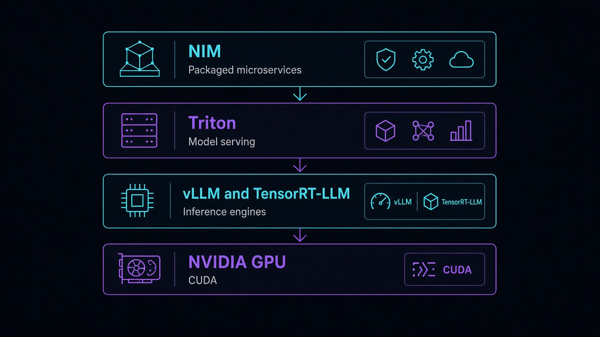
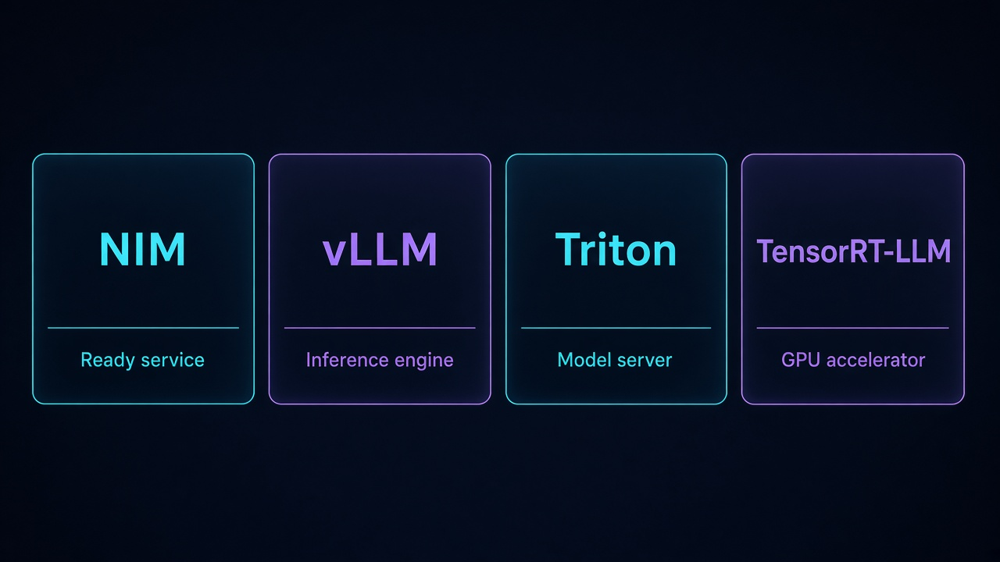
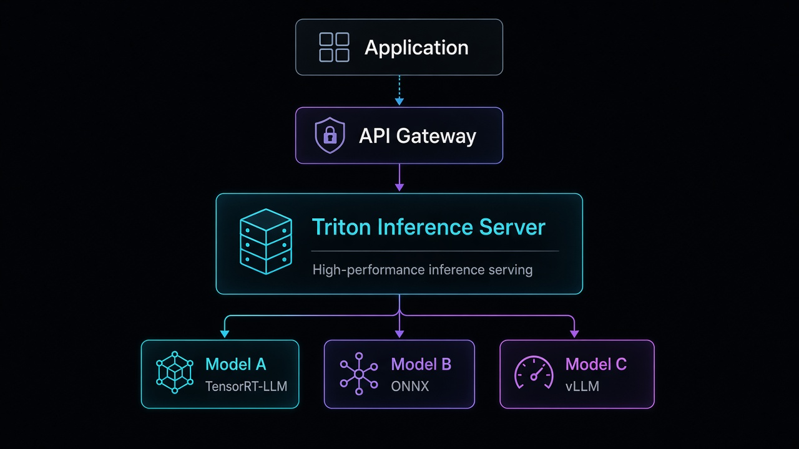
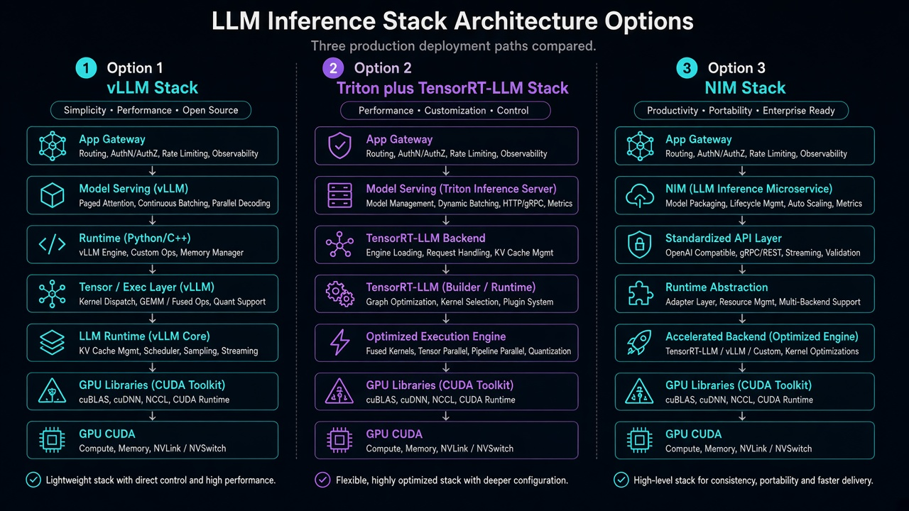
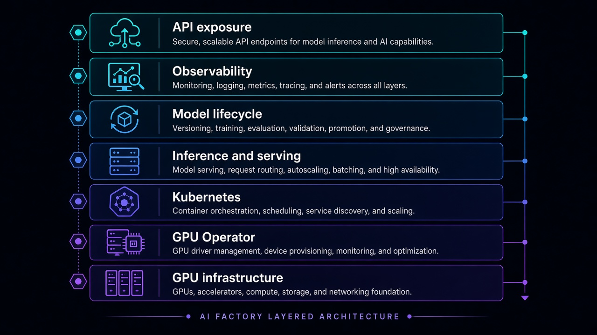

# NVIDIA NIM vs vLLM vs Triton vs TensorRT-LLM

**Type:** Deep-dive comparison  
**Audience:** Cloud / AI Platform Architects  
**Updated:** 2026-11-19

These four technologies are related, but they solve **different problems** in the LLM inference and model-serving stack.

The easiest way to understand them:

- **NVIDIA NIM** — Ready-to-deploy, optimized AI inference microservices.
- **vLLM** — High-performance LLM inference engine.
- **NVIDIA Triton Inference Server** — Model-serving platform that manages and serves different types of models.
- **TensorRT-LLM** — NVIDIA's inference optimization and execution framework for LLMs.

They are **not all direct competitors**. Some work together in the same production architecture.



---

## 1. High-level comparison



| Technology | Primary responsibility | Think of it as |
| --- | --- | --- |
| **NVIDIA NIM** | Packaged AI inference deployment | Ready-made AI service |
| **vLLM** | LLM inference and scheduling | LLM execution engine |
| **Triton** | Model serving and orchestration | Model-serving server |
| **TensorRT-LLM** | GPU inference optimization | LLM acceleration engine |

**Important:** Triton is a **server**, TensorRT-LLM is an **inference framework/backend**, and vLLM is an **inference engine**. NIM packages deployment components into production-ready microservices.

---

## 2. Understand each technology

### A. NVIDIA NIM

**NIM** = NVIDIA Inference Microservices.

It provides prebuilt, optimized containers and APIs so you can deploy AI models without manually assembling the full inference-serving stack.

**What it provides**

- Preconfigured inference containers
- OpenAI-compatible API endpoints for supported models
- Optimized model execution
- Containerized deployment
- Kubernetes integration
- Monitoring and enterprise deployment capabilities

**Example**

You want to deploy Llama 3.1 70B. Instead of wiring the engine, weights, runtime, and API server yourself, deploy an appropriate NIM container. Your application calls:

```bash
curl -X POST https://nim.example.com/v1/chat/completions \
  -H "Content-Type: application/json" \
  -H "Authorization: Bearer $NIM_API_KEY" \
  -d '{
    "model": "meta/llama-3.1-70b-instruct",
    "messages": [
      {"role": "user", "content": "Summarize multi-cloud GPU inference."}
    ],
    "temperature": 0.2,
    "max_tokens": 512
  }'
```

NIM handles inference execution internally.

**Kubernetes sketch**

```yaml
apiVersion: apps/v1
kind: Deployment
metadata:
  name: nim-llama-70b
spec:
  replicas: 2
  selector:
    matchLabels:
      app: nim-llama-70b
  template:
    metadata:
      labels:
        app: nim-llama-70b
    spec:
      containers:
        - name: nim
          image: nvcr.io/nim/meta/llama-3.1-70b-instruct:latest
          ports:
            - containerPort: 8000
          resources:
            limits:
              nvidia.com/gpu: 4
          env:
            - name: NGC_API_KEY
              valueFrom:
                secretKeyRef:
                  name: ngc-secret
                  key: NGC_API_KEY
```

---

### B. vLLM

vLLM is an open-source, high-throughput **LLM inference engine**.

Its main objective: serve many concurrent LLM requests efficiently.

**Key features**

- PagedAttention
- Continuous batching
- Efficient GPU memory management
- Tensor parallelism
- Distributed inference
- OpenAI-compatible API server

**Example**

Multiple users hit the same Llama 70B deployment:

```text
User 1 → Prompt A
User 2 → Prompt B
User 3 → Prompt C
```

vLLM dynamically schedules requests and manages KV cache memory to improve GPU utilization and throughput.

**Serve with vLLM**

```bash
python -m vllm.entrypoints.openai.api_server \
  --model meta-llama/Meta-Llama-3.1-70B-Instruct \
  --tensor-parallel-size 4 \
  --gpu-memory-utilization 0.90 \
  --max-model-len 8192 \
  --port 8000
```

**Client call (OpenAI-compatible)**

```python
from openai import OpenAI

client = OpenAI(base_url="http://vllm:8000/v1", api_key="EMPTY")

resp = client.chat.completions.create(
    model="meta-llama/Meta-Llama-3.1-70B-Instruct",
    messages=[{"role": "user", "content": "Explain PagedAttention in one paragraph."}],
    temperature=0.1,
)
print(resp.choices[0].message.content)
```

**Key point:** vLLM is an inference engine — not a Kubernetes orchestration platform.

---

### C. NVIDIA Triton Inference Server

Triton is a **general-purpose model-serving platform**.

It supports many ML frameworks and backends, for example:

- TensorRT
- TensorRT-LLM
- ONNX Runtime
- PyTorch
- Python backend
- vLLM (via supported backends / deployment configs)



Triton manages model loading, inference requests, batching, and serving through a common interface. It shines when you must serve **different AI/ML models**, not only LLMs.

**Minimal model repository layout**

```text
model_repository/
  llama70b_trtllm/
    config.pbtxt
    1/
      model.plan
  classifier_onnx/
    config.pbtxt
    1/
      model.onnx
```

**Example `config.pbtxt` (TensorRT-LLM backend sketch)**

```protobuf
name: "llama70b_trtllm"
backend: "tensorrtllm"
max_batch_size: 64

instance_group [
  {
    count: 1
    kind: KIND_GPU
  }
]

parameters: {
  key: "gpt_model_type"
  value: { string_value: "inflight_fused_batching" }
}
```

**Start Triton**

```bash
docker run --gpus all --rm -p 8000:8000 -p 8001:8001 -p 8002:8002 \
  -v $PWD/model_repository:/models \
  nvcr.io/nvidia/tritonserver:24.12-py3 \
  tritonserver --model-repository=/models
```

---

### D. TensorRT-LLM

TensorRT-LLM is NVIDIA's framework for **optimizing and executing** LLM inference on NVIDIA GPUs.

Focus: **performance**.

**Key capabilities**

- Model optimization
- Quantization
- FP16 / BF16 / FP8 (hardware + model dependent)
- Tensor and pipeline parallelism
- KV cache optimization
- GPU-specific kernel optimizations

**Example goals on H100**

Improve:

- Tokens per second
- Time to first token
- GPU utilization
- Memory efficiency
- Concurrent request throughput

TensorRT-LLM can run through its own runtime **or** be served via Triton.

**Build / convert sketch**

```bash
# Convert Hugging Face checkpoint → TensorRT-LLM engine (illustrative)
python convert_checkpoint.py \
  --model_dir ./Llama-3.1-70B-Instruct \
  --output_dir ./tllm_checkpoint \
  --dtype float16 \
  --tp_size 4

trtllm-build \
  --checkpoint_dir ./tllm_checkpoint \
  --output_dir ./engines/llama70b \
  --gemm_plugin float16 \
  --max_batch_size 64 \
  --max_input_len 4096 \
  --max_seq_len 8192
```

---

## 3. How they work together



### Option 1 — Simple LLM deployment with vLLM

```text
Application / API Gateway
            │
          vLLM
   (inference engine + API)
            │
   NVIDIA GPU + CUDA
```

**Best when:** you want straightforward, high-throughput open-source LLM serving.

### Option 2 — Triton + TensorRT-LLM

```text
Application / API Gateway
            │
   Triton Inference Server
            │
   TensorRT-LLM Backend
            │
   NVIDIA GPU + CUDA
```

**Best when:** you want Triton's serving features with TensorRT-LLM execution.

### Option 3 — NVIDIA NIM

```text
Application / API Gateway
            │
        NVIDIA NIM
  (packaging + API + deploy)
            │
 Inference engine (vLLM / SGLang in NIM LLM 2.x)
            │
   NVIDIA GPU + CUDA
```

**Best when:** you want a packaged, supported enterprise deployment experience.

**Clarification:** NIM is **not** just another name for Triton. Current NIM LLM 2.x packages **vLLM** or **SGLang** as the inference engine. Older NIM architectures and other NVIDIA serving configs can involve Triton and TensorRT-LLM.

---

## 4. When should you choose which?

| Requirement | Recommended |
| --- | --- |
| Quickly deploy an enterprise LLM | **NIM** |
| Open-source LLM serving | **vLLM** |
| Serve multiple ML model types | **Triton** |
| Optimize NVIDIA GPU LLM inference | **TensorRT-LLM** |
| Standardized model-serving infrastructure | **Triton** |
| Custom LLM deployment and tuning | **vLLM** or **TensorRT-LLM** |

---

## 5. Kubernetes / NVIDIA AI Factory fit



| Layer | Technology |
| --- | --- |
| GPU infrastructure | NVIDIA DGX / HGX / H100 / H200 / B200 |
| GPU management | NVIDIA GPU Operator |
| Container orchestration | Kubernetes |
| Model inference | NIM / vLLM / TensorRT-LLM |
| Model serving | Triton (where required) |
| Model lifecycle | NVIDIA NeMo / MLflow |
| Observability | Prometheus / Grafana / DCGM |
| API exposure | Ingress / API Gateway |

---

## 6. Decision criteria for platform architects

Use non-functional requirements to choose — not brand preference.

| Criterion | Prefer NIM | Prefer vLLM | Prefer Triton + TensorRT-LLM |
| --- | --- | --- | --- |
| Time-to-production | Fastest packaged path | Fast if your team owns the stack | Slower; more assembly |
| Operational ownership | NVIDIA / partner-supported images | Your platform team | Your platform + ML eng |
| Multi-model / multi-framework | Limited to NIM catalog | LLM-focused | Strong (many backends) |
| Latency / throughput tuning | Good defaults; less low-level control | Strong continuous batching & KV management | Highest NVIDIA-specific optimization headroom |
| Hardware lock-in | NVIDIA-centric | Broader GPU options where supported | NVIDIA-optimized |
| Compliance / private cloud | Enterprise packaging + K8s | Full control of images and configs | Full control; more moving parts |

**Rule of thumb:** start with the smallest stack that meets SLOs. Add Triton or TensorRT-LLM only when serving topology or GPU efficiency clearly requires them.

---

## 7. Common misconceptions

- **Triton is not mandatory for LLM production.** Many platforms run vLLM (or NIM) behind Kubernetes Services and an API gateway without Triton.
- **NIM is not "just Triton renamed."** Current NIM LLM 2.x packages engines such as **vLLM** or **SGLang**; Triton + TensorRT-LLM remain a separate composition pattern.
- **Triton can front multiple engines.** Where backends are supported, Triton can serve TensorRT-LLM and vLLM-style workloads in one serving fabric — validate versions on your CUDA / driver stack.
- **TensorRT-LLM is not universally "faster than vLLM."** Gains depend on model, GPU SKU, batching, quantization, and sequence lengths. Benchmark on *your* traffic.
- **Running all four does not equal a better platform.** Extra layers without clear ownership increase failure modes and change-management cost.

**Official references**

- [NVIDIA NIM documentation](https://docs.nvidia.com/nim/)
- [vLLM documentation](https://docs.vllm.ai/)
- [Triton Inference Server documentation](https://docs.nvidia.com/deeplearning/triton-inference-server/)
- [TensorRT-LLM documentation](https://nvidia.github.io/TensorRT-LLM/)

---

## Architectural takeaway

> **NIM** simplifies enterprise deployment.  
> **vLLM** and **TensorRT-LLM** execute and accelerate LLM inference.  
> **Triton** is an optional general-purpose model-serving control plane.

They are **complementary** layers — select by SLO, ownership model, and operational maturity, not by collecting every NVIDIA component.
